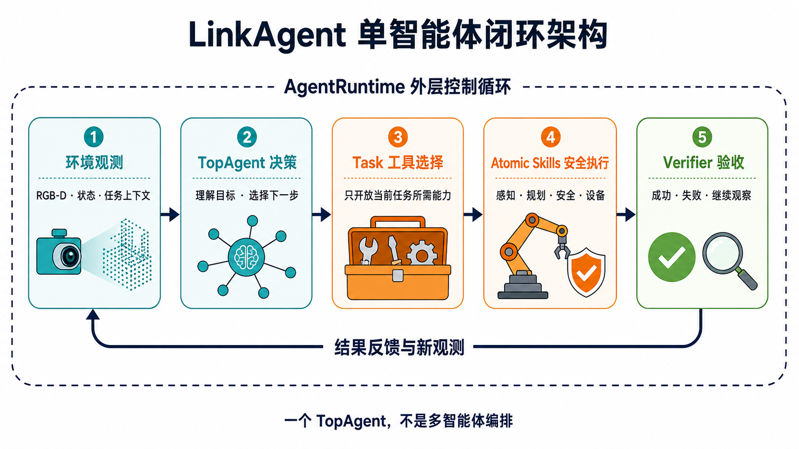
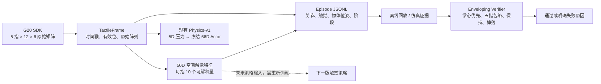
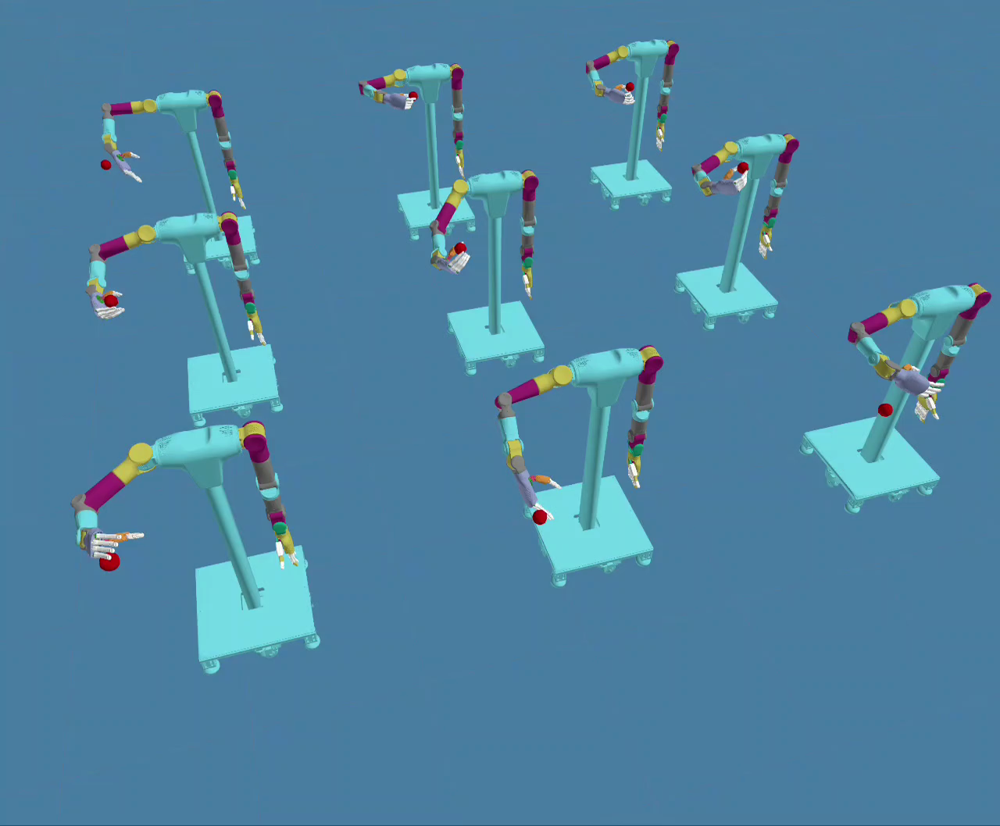
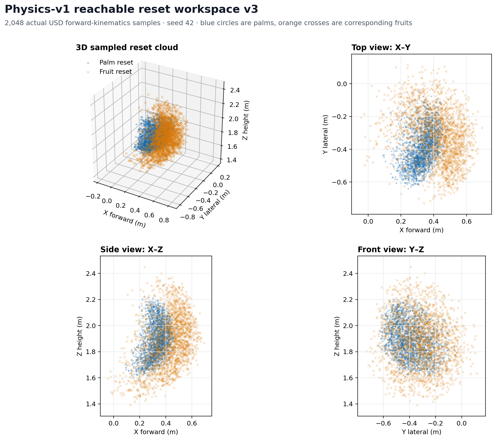

# RealAgent

> **本研究分支的老师审阅入口（2026-10-20更新）**：[最新：首轮约3亿样本完成，持续旋转0/128，完整数据与分析](research/roto2_review/2026-10-20/v8-stage1-300m/README.md) · [阶段0：256个可松指初态验收通过](research/roto2_review/2026-10-20/v8-stage0-passed/README.md) · [v8早期失败实验](research/roto2_review/2026-10-20/v8/README.md) · [v1–v7训练历史](research/roto2_review/2026-10-20/README.md)。本轮299,993,792样本、2293次PPO更新；最终两组10秒后平均净转角20.87°/18.26°，阶段1未通过。下一轮仅加强归一化抓姿恢复代价，从头训练；网络与PPO架构不变。训练完成不等于目标完成，早期失真指标已撤回。

RealAgent 是一个可运行的单 `TopAgent` 系统：外层 Runtime 管理观测、控制步和资源生命
周期，内层 Agent 管理有界的模型/工具往返。默认配置完全离线；第二阶段已经加入
`doubao-seed-2.0-pro` 的 Ark OpenAI Responses 与 Anthropic Messages 兼容协议适配。

## 一眼看懂 Agent 架构

<p align="center">
  
</p>

LinkAgent 不是一群 Agent 相互讨论，而是一个 `TopAgent` 在明确边界内完成闭环：看见环境、
理解任务、选择工具、调用安全技能，并由独立验证器判断“成功、失败，还是继续观察”。

| 看见 | 决策 | 选择能力 | 安全执行 | 验收结果 |
|---|---|---|---|---|
| RGB-D、机器人状态和任务上下文 | `TopAgent` 决定下一步 | `Task` 只开放当前需要的工具 | `Atomic Skills` 连接感知、规划、安全与设备 | `Verifier` 用事实关闭闭环 |

这样设计的重点不是“让模型自由发挥”，而是让每一步都有权限边界、执行记录和可验证结果。
下方展示的番茄采摘，就是这套架构中的一个可运行任务。

当前仓库收敛为两条清晰主线：一套单 Agent 闭环框架，以及三项可复现的 PPO 实验。
生产采摘链路中的真实感知和真机动作尚未接入；默认 Agent 示例仍使用确定性 mock，PPO
结果均来自 Isaac 仿真。训练 checkpoint、resolved config、固定评测和续训入口随对应实验发布。

<details>
<summary><strong>展开查看 Agent 能力与集成边界</strong></summary>

`AgriPickTask` 只开放 5 个任务级工具，设备按双臂、每臂 7 关节及左右 G20 建模；独立
Verifier 负责确认果实脱离、稳定持有且没有滑落。`HarvestCycleTask` 在 PPO pick 前后串联
系统自检、RGB-D 感知、目标筛选、遮挡重观察、净空检查、带载运输、容器放置、掉果恢复和
闭环验收。所有新增能力使用统一 `AtomicSkill` 合约和有界结构化轨迹。

视觉 Worker 与 Agent 核心进程隔离；三维几何始终由本地 aligned depth 和相机内参计算，
VLM 不直接提供机器人位姿或动作。完整 PhysX 验收边界见
[`ISAAC_SIM_ACCEPTANCE.md`](./docs/harvest_cycle/ISAAC_SIM_ACCEPTANCE.md)。

独立的能力验证 Task 额外提供离线 IK/相机 Replay，以及真机遥测、Shadow IK 和本地
Orbbec 状态三个只读工具。真机适配器默认关闭，必须同时由配置和环境变量显式放行；工具
不暴露使能、目标写入、轨迹或手部控制。

</details>

## 从原始触觉到可复现抓取评估

G20 每根手指提供一张 `12×6` 触觉矩阵。LinkAgent 现在保留完整的五指原始空间信息，
同时把采样过程记录成可回放 episode，再由独立 Verifier 判断抓取是否真正形成掌心支撑、
五指包络和断梗后稳定保持。整条链路是现有 Agent 的证据旁路，不会绕过 Task/Skill
边界直接控制硬件。



| 新增能力 | 直接产物 | 现在解决什么问题 |
|---|---|---|
| [原始矩阵特征](./module/skills/tomato_pick/tactile_matrix.py) | 五指共 50D：总载荷、峰值、接触面积、压力中心、分布宽度、载荷变化率、有效/掉线标记 | 区分“没有接触”和“传感器无效”，保留接触在指腹上的位置与形状 |
| [触觉 Episode](./module/skills/tomato_pick/tactile_episode.py) | 可流式保存、可确定性回放的 JSONL | 把 16D 手部关节、`5×12×6` 原始矩阵、采样年龄、物体位姿和动作阶段对齐到同一时间线 |
| [包络抓取 Verifier](./module/skills/tomato_pick/enveloping_verifier.py) | `pass` 或掌心支撑缺失、包络不足、拇指对向不足、远端关节空闲、掉落等明确原因 | 用独立证据评价抓取，不把 PPO reward 或单帧接触当作任务成功 |

这里的触觉矩阵仍是 SDK 原始量纲，不宣称等价于牛顿；真实力阈值需要后续标定数据。
新增 50D 特征也没有替换已发布模型的输入：Physics-v1/Clean-v5 继续使用冻结的
`g20_pressure_5d_v1` 与 66D Actor，保证现有 checkpoint 契约不漂移。Verifier 当前用于
CPU、仿真和记录回放，它的通过结果不等于真机运动授权。

## 三项 PPO 实验成果

| 实验 | 发布 checkpoint | 固定评测成功率 | 定位 |
|---|---:|---:|---|
| 1. Minimal-v3 / GraspCredit | `model_1450.pt` | **62.57%**；seed 2026 为 **63.65%** | 首个完整可复现基线 |
| 2. Clean-v5 | `model_1350.pt` | **96.18%** | 当前成功率最高、推荐使用 |
| 3. Physics-v1 perf-v7 | `model_5150.pt` | **85.97%** | 更完整物理约束与可视化 Demo |

三项实验都按“一个实验、一个最终选定 checkpoint”介绍。训练过程中的恢复点只保留在所属
实验的谱系中，不作为独立成果。Minimal-v3 的配置、评测与续训命令见
[`PPO_MODEL1450_REPRODUCTION.md`](./docs/tomato_pick/PPO_MODEL1450_REPRODUCTION.md)；Clean-v5 见
[`PPO_CLEAN_V5_MODEL1350_REPRODUCTION.md`](./docs/tomato_pick/PPO_CLEAN_V5_MODEL1350_REPRODUCTION.md)。

### Physics-v1：从 PPO 训练到可复现 Demo

<p align="center">
  <a href="./docs/tomato_pick/assets/physics_v1/physics_v1_demo.mp4">
    
  </a>
</p>

<p align="center"><strong>▶ 点击画面播放 36.6 秒 Demo</strong></p>

| 固定三种子成功率 | 完成 episode | 最差种子成功率 | 最终 checkpoint |
|---:|---:|---:|---:|
| **85.97%** | **20,102** | **85.62%** | **iter 5150** |

Physics-v1 展示了 A7 双臂与多指手在大量并行仿真环境中，从不同初始位置接近番茄、形成
抓持、完成脱离并稳定保持的完整动作。最终 `model_5150.pt` 在固定种子 17、42、2026
上完成 17,282 次成功，drop rate 为 6.78%。原定 90% 目标没有达到；模型是在用户审阅
曲线后停止并选出的最佳已测试 checkpoint，而不是把训练过程指标包装成最终成绩。

### 真实可达空间采样

<p align="center">
  
</p>

蓝点是 2,048 个实际 USD 前向运动学得到的手掌位置，橙色叉号是对应番茄位置；全部样本
通过闭合位姿 IK 可达性检查，初始最大接触力为 0 N。图不是手绘示意，配套 CSV 和 JSON
也随仓库提供，可重新检查每个采样点。

[查看完整图文成果页](./docs/tomato_pick/PHYSICS_V1_SHOWCASE.md) ·
[查看最终训练与复现说明](./docs/tomato_pick/PHYSICS_V1_PERF_V7_FINAL_5150.md)

## Physics-v2 Research Preview（不计入三项 PPO 成果）

Physics-v2 当前没有可发布的成功 checkpoint，也不计入上面的三项实验结果。下一轮首成功
门禁候选已冻结为
`physics_v2_retention_objective_v1`。当前随仓证据中，CPU public-prior Q1--Q6
资格检查通过，64 环境 x 128 步的 managed-Isaac 无训练 smoke 为 25/25 通过；
上一版 repair 46 的 `8192 x 32 x 50`、seed 42 门禁完整运行但仍为零成功和零尾段
保持，因此不能作为成功模型或可续训发布 checkpoint。

repair 47 只把 Physics-v2 的稠密防停滞代价保持在原有 `-0.01` 端点，其余物理、
PPO、观测、断裂、保持和最终成功判据不变。这个新版候选尚未运行正式规模的首成功门禁，
正式长训也未获授权或启动；真实硬件仍未连接。代码、冻结配置、输入哈希、历史失败报告、
门禁策略和逐项修复依据见
[`PHYSICS_V2_EXTERNAL_AUDIT.md`](./docs/tomato_pick/PHYSICS_V2_EXTERNAL_AUDIT.md)、
[`PHYSICS_V2_PUBLIC_PRIOR_IMPLEMENTATION.md`](./docs/tomato_pick/PHYSICS_V2_PUBLIC_PRIOR_IMPLEMENTATION.md)
和
[`TRAINING_REPAIR_AUDIT_2026-08-14.md`](./research/physics_v2_public_priors/TRAINING_REPAIR_AUDIT_2026-08-14.md)。

<details>
<summary><strong>展开查看 Physics-v2 预检命令</strong></summary>

在不启动 Isaac 或 PPO 的情况下核对下一次精确训练命令：

```bash
export LINKAGENT_ISAACLAB_ROOT=/absolute/path/to/IsaacLab-3.0.0-beta2.patch1
PYTHONPATH="$PWD" \
  "$LINKAGENT_ISAACLAB_ROOT/env_isaaclab/bin/python" \
  script/gate_tomato_physics_v2_first_success.py --preflight-only
```

预检必须输出 `training_started=false`、上述候选 ID，以及固定的
`8192 x 32 x 50`、seed 42 from-scratch 命令。只有该门禁产生当前哈希匹配的通过报告后，
曲线控制器才允许开始正式长训。

</details>

## 快速开始

要求 Python 3.11 或更高版本。项目没有第三方运行时硬依赖。

默认离线运行不需要 API key：

```bash
python -m script.run --config config/default.yaml
```

运行完整单元测试和编译检查（完整测试需要记录的 Isaac/PyTorch 环境）：

```bash
export LINKAGENT_ISAACLAB_ROOT=/absolute/path/to/IsaacLab-3.0.0-beta2.patch1
"$LINKAGENT_ISAACLAB_ROOT/env_isaaclab/bin/python" -m pytest -q
python -m compileall module proto task script tests
```

测试只使用 mock/fake gateway/无物理契约环境，不联网、不连接 CAN、不读取真实凭据；
它们不会启动 Isaac 仿真或 PPO 训练。

运行 C1 离线番茄采摘闭环：

```bash
python -m script.run --config config/agri_pick_mock.yaml
```

运行包含重观察、带载回撤、放置和独立验收的离线采摘周期：

```bash
python -m script.run --config config/harvest_cycle_mock.yaml
```

运行必须经历“遮挡→换视角→重新识别”的闭环：

```bash
python -m script.run --config config/harvest_cycle_active_view_mock.yaml
```

验证隔离视觉 Worker 的真实跨进程闭环（分别在两个终端运行）：

```bash
python -m script.tomato_vision_worker --config config/tomato_vision_worker_replay.yaml
python -m script.run --config config/harvest_cycle_worker_replay.yaml
```

使用 Ark 真实多模态框选完成合成 RGB-D 跨进程采摘闭环：

```bash
set -a; . ./.env.local; set +a
python -m script.tomato_vision_worker --config config/tomato_vision_worker_ark_box.yaml
# 另一个终端，同样载入 ARK_API_KEY：
python -m script.run --config config/harvest_cycle_worker_ark.yaml
```

`ark_vlm_box` 是 YOLO 权重到位前的临时后端：Ark 返回 0–1000 归一化 box、中心点、果梗点和
语义分数；Worker 本地映射像素、结合 aligned depth 构造保守支持区域、拟合三维椭球并追踪
目标。合成输入可由 `python -m script.generate_tomato_vision_sim_capture` 重建。

准备位移动前会调用 `pregrasp_clearance_check`。它从配置端口取得 world-frame 场景点，剔除
选中果实椭球内点，对“当前末端→预抓取→接触→果心”三段路径做扫掠净空检查；检查本身不
发送动作，阻挡、场景过期或覆盖不足时不会启动准备位移动或 PPO。默认配置用确定性场景，
`observation_pointcloud` 端口为后续深度相机保留同一合同。

采摘验证后不再从果树回撤点直接移动到容器。`transport_payload` 先垂直抬升，再低速移动到
由容器位姿和固定高度偏移生成的前置位；起点、抬升终点和运输终点都读取手部与五指触觉。
掉果或保持不足会锁住放置，`place_tomato` 只允许从该次运输绑定的前置位短距离下探并松手。

一次放置验收完成后，可显式调用 `reset_for_next_target`：它确认手为空，将机械臂移回配置观测位，
清除本周期的目标、计划和 PPO execution 绑定，同时保留周期验证历史。下一次检测必须来自新的
observation sequence；离线测试已连续完成两个独立采摘周期。

RGB-D 采集数据面现已支持原子 spool、`latest.json` 严格新帧、录制导入和 recorded-shadow
审计。硬件未接入时可先校验 profile；有 raw RGB-D 录制后再执行导入和审计：

```bash
python -m script.audit_tomato_vision_spool \
  --profile config/tomato_vision_spool_recorded_shadow.yaml \
  --output artifacts/vision_spool/recorded-shadow-audit.json
```

profile 默认要求 100 帧，所以空目录或不完整录制会失败，这是预期的准入行为。Orbbec
厂商 adapter、真实标定、YOLO 权重和 VLM endpoint 尚未随仓提供，不会自动降级成 viewer
预览或旧视觉 metadata。详细接缝和录制导入命令见
[`docs/harvest_cycle/VISION_WORKER.md`](./docs/harvest_cycle/VISION_WORKER.md)。

运行无物理契约门禁（不会启动 Isaac 或 PPO）：

```bash
python3.12 -m script.sim_env preflight --role contract_smoke
python3.12 -m script.sim_env smoke --episodes 100 --seed 0
python3.12 -m script.train_tomato_ppo
```

前两条应通过；第三条会输出训练计划，并在缺少 Isaac Lab 路径或 W&B 登录时列出阻塞项。

隔离的 Isaac 主运行时、重复 smoke 命令和已知依赖说明见
[`docs/tomato_pick/C2_ISAAC_RUNTIME.md`](./docs/tomato_pick/C2_ISAAC_RUNTIME.md)；已经执行的
资产决策和训练前唯一阻塞见
[`docs/tomato_pick/C2_SIM2REAL_TRAINING_PREP.md`](./docs/tomato_pick/C2_SIM2REAL_TRAINING_PREP.md)。

## Ark 真实模型

凭据只从进程环境读取，不写入 YAML、源码或日志。设置 `ARK_API_KEY` 后，可分别运行：

```bash
export ARK_API_KEY="<your-key>"
python -m script.run --config config/ark_openai.yaml
python -m script.run --config config/ark_anthropic.yaml
unset ARK_API_KEY
```

随仓 profile 使用：

|配置|协议|Base URL|
|---|---|---|
|`config/ark_openai.yaml`|OpenAI Responses|`https://ark.cn-beijing.volces.com/api/coding/v3`|
|`config/ark_anthropic.yaml`|Anthropic Messages|`https://ark.cn-beijing.volces.com/api/coding`|

两条真实冒烟路径均已验证完整的“模型请求工具 → 本地执行 `locate_target` → 把工具结果
交回模型 → 返回终态”流程。接入使用标准库 HTTPS 和中立内部契约，没有引入 OpenAI、
Anthropic 或 LangChain SDK 类型。

## 番茄采摘与离线设备适配

- [设备能力基线](./docs/tomato_pick/SDK_CAPABILITY_BASELINE.md)：7 轴机械臂、G20、触觉、
  仿真资产和旧 PPO 的审计结论；
- [接口规范](./docs/tomato_pick/INTERFACE_SPEC.md)：Ports、Task tools、114D/7D PPO、
  状态机、成功和失败语义；
- [C2-0 开工规范](./docs/tomato_pick/C2_ZERO_SPEC.md)：正式模型、触觉单位、番茄/果梗
  环境边界和规则策略训练门禁；
- [C2-1 环境规范](./docs/tomato_pick/C2_ONE_ENVIRONMENT.md)：三套运行环境、无物理
  114D/7D 环境、PPO 配置和受控启动门禁；
- [全局架构复核](./docs/tomato_pick/ARCHITECTURE_REVIEW.md)：当前完成度、代码落点和
  C1～C5 路线。

C1 已完成完全离线的 `AgriPickTask + TomatoPickSkillRunner` 闭环；C2 已运行契约 smoke、
Isaac 物理门禁、PPO 数值探针和正式训练，并把 Agent、契约测试、Isaac/PPO 三套环境
隔离。下一阶段是 C3 真实感知、触觉标定和 sim-to-real 验收。

采摘周期的能力边界、证据链、真实硬件接入门禁和后续原子能力优先级见
[`docs/harvest_cycle/ATOMIC_SKILLS_ROADMAP.md`](./docs/harvest_cycle/ATOMIC_SKILLS_ROADMAP.md)。
视觉选择、三维点云、PPO 9 维输入、准备位训练分布和真实相机接入门禁见
[`docs/harvest_cycle/VISION_TO_PPO_PIPELINE.md`](./docs/harvest_cycle/VISION_TO_PPO_PIPELINE.md)。
隔离 Worker、raw RGB-D sidecar、真实 YOLO/VLM 配置和失败边界见
[`docs/harvest_cycle/VISION_WORKER.md`](./docs/harvest_cycle/VISION_WORKER.md)。
Orbbec Gemini Pro 的当前只读接入方式、自检项目和离线限制见
[`docs/harvest_cycle/SYSTEM_SELF_CHECK.md`](./docs/harvest_cycle/SYSTEM_SELF_CHECK.md)。

C4-O 已完成 SDK-neutral gateway 契约、LinkBot/G20 DTO 转换、双臂双手生命周期、控制
租约、只读门禁、命令幂等、全系统急停以及四设备部署模板。它没有导入供应商 SDK，
也没有注册成默认后端。真实连接时仍需补齐 vendor gateway、最终 CAN endpoint、右手
标定和 shadow/单命令验收；在此之前不会误进入硬件模式。

## 架构摘要

系统只有一个 `TopAgent`，其他对象都是职责组件：

- `AgentRuntime` 管理外层控制循环、最新观测和生命周期；
- `TopAgent` 管理单次调用内的模型决策/工具往返；
- Task 拥有 prompt、工具白名单、输入构建和可验证完成条件；
- Env 负责 reset、取观测、通用动作入口和环境资源释放；
- perception/manipulation 通过中立 DTO 和显式 Factory 提供能力；
- composition root 读取配置并按显式顺序组装。

```text
AgentRuntime.run()
  -> env.reset()                         # 直接取得首帧
  -> task.run(runtime)
       -> 外层控制步（最多 max_steps 次）
            -> TopAgent.invoke(...)
                 -> 模型/工具循环
                    （iterations、总 tool-call、单轮 tool-call 三重预算）
            -> task.is_complete(...)
            -> 必要时 env.get_obs()
  -> task.close()
  -> env.close()
```

Task 给出的工具列表就是完整权限白名单。模型只能看到只读的
`AgentToolSpec(name, description, parameters)`；`parameters` 是受大小和结构约束的
object JSON schema，实际 handler 始终只由 `TopAgent` 持有。schema 可显式提供，也可
从可信 Python handler 签名保守推断。

## 关键边界

- `env.reset()` 的返回值直接作为第一步观测，不重复采集首帧。
- 参数绑定错误和显式 `RecoverableToolError` 会作为 error tool message 交还模型；
  未知基础设施异常继续向外传播。
- Runtime 总会尝试按 `task.close()`、`env.close()` 顺序清理；组装阶段也遵守资源回收
  边界。
- 消息与日志共享脱敏器，并限制二进制、集合、嵌套和字符串体积。
- Provider transport 只接受无 URL 凭据的 HTTPS Base URL，并限制超时、请求体和响应
  体；错误只暴露有界且脱敏的摘要。
- 缺少 `ARK_API_KEY` 时，在获取 Env/Task 资源之前失败；默认 mock 配置不要求凭据。
- 自动重试、流式输出、内置联网工具和长期会话尚未实现；避免在未设计幂等与状态恢复
  前引入重复调用或计费风险。

配置文件采用 JSON-compatible YAML，因此标准库 `json` 即可解析；若环境中已有
PyYAML，加载器可选择性解析普通 YAML。

完整开发契约见 [preview.md](./preview.md)，阶段目标、范围和逐项证据见
[IMPLEMENTATION_PLAN.md](./IMPLEMENTATION_PLAN.md)。两份文档均应在每轮实现后与代码
和测试重新对齐。
