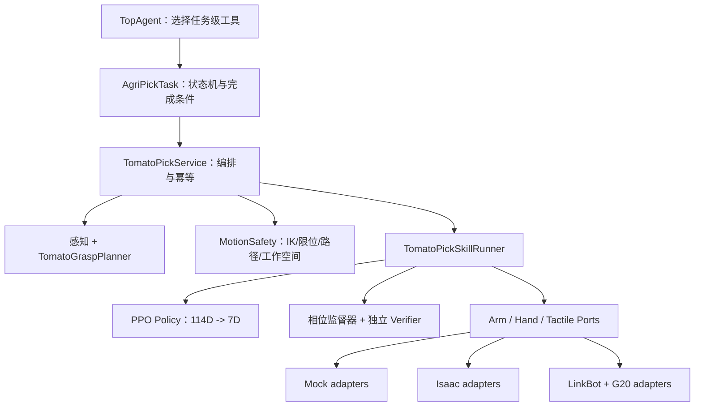

# 番茄采摘全局架构复核与后续路线

状态：C1、C2-0/C2-1、C2-2 DirectRLEnv 与 C4-O 已落地；物理规则策略验收进行中  
日期：2026-08-04  
规范入口：[INTERFACE_SPEC.md](./INTERFACE_SPEC.md)；C2 开工/环境规范：
[C2_ZERO_SPEC.md](./C2_ZERO_SPEC.md)、
[C2_ONE_ENVIRONMENT.md](./C2_ONE_ENVIRONMENT.md)、
[C2_ISAAC_RUNTIME.md](./C2_ISAAC_RUNTIME.md)、
[C2_TWO_ASSET_PHYSICS_PROPOSAL.md](./C2_TWO_ASSET_PHYSICS_PROPOSAL.md)、
[C2_SIM2REAL_TRAINING_PREP.md](./C2_SIM2REAL_TRAINING_PREP.md)

## 1. 最终判断

通用 Agent“大脑”和 C1 离线下游已经完成。5 个番茄任务级工具现在通过
`TomatoPickService` 驱动 Mock 感知、规划、安全、Skill 和独立 Verifier；MoveJ、IK、
FollowP 或 G20 20 维命令仍没有直接交给大模型。

现在不需要继续扩展多 Agent、长期记忆、RAG、工作流引擎或模型路由，也不需要重新
开发机械臂 IK。现有 7 轴 FK/IK 和高级运动控制足够作为执行底座。

## 2. 当前真实完成度

|层|当前状态|证据/说明|
|---|---|---|
|Agent Runtime|已实现并验证|单 TopAgent、双层有界循环、工具白名单、生命周期|
|模型 adapter|已实现并验证|Ark OpenAI Responses 与 Anthropic Messages tool-call 往返|
|通用 mock 下游|已实现|Mock Env、感知、manipulation；`locate_target` 保持可用|
|设备 SDK|设备仓内已实现，未接 RealAgent|双 7 轴臂；FK/IK、MoveJ/JP/L、FollowP；G20 控制与触觉|
|番茄接口与 C1 mock|已实现|Ports、114D/7D、manifest、控制租约、G20 mapper|
|AgriPickTask|已实现|Registry 中注册 `agri_pick`，只暴露 5 个任务级工具|
|Mock Pick Skill|已实现|四阶段 runner、相位 supervisor、失败分类、幂等和取消|
|番茄感知/抓取位姿|Mock 已实现，真实未实现|目标、果梗方向、预抓取/接触/拉脱 DTO 已跑通|
|新番茄 PPO|未开始|旧 Fruit-Grasp baseline 明确隔离，不复用|
|C2-0 仿真契约|已完成|唯一模型/安装方向、触觉单位、114D/7D/20 Hz 和规则策略门禁已自动校验|
|C2-1 环境骨架|已完成|无物理 114D/7D Env、100-seed 规则策略、三环境隔离和 PPO 启动门禁|
|C2-2A Isaac 运行时|已完成|Sim 6.0.1、RTX 5090 CUDA PhysX、正式 USD 71-body/56-DOF smoke|
|番茄/果梗 DirectRLEnv|已实现，训练前验收中|114D actor、33D critic、7D action、相关椭球、向量化可断果梗已通过短 CUDA smoke|
|指尖接触/自碰撞|未完成|临时关节反力会产生假过力；需 contact reporter overlay 和 pose sweep|
|独立成功验证器|Mock 已实现，真实未实现|PPO 不能自报成功；视觉输入位已保留|
|SDK adapter/真机联调|离线转换层已实现，真机未接|gateway 契约、双臂双手生命周期、只读/租约/急停已测；vendor gateway 与 shadow 待真机|
|离线验证|已完成|130 项回归；默认不启动 Isaac/ROS/CAN；Isaac 物理 smoke 单独显式运行|

因此可以说“Agent 平台完成”，不能说“农业机器人系统完成”。接下来主要工作量在任务
语义、技能、感知/几何、仿真和设备适配，不在 LLM 框架。

## 3. 冻结后的层级



关键依赖方向：

- Agent 依赖 Task 提供的工具描述，不依赖机器人 SDK；
- Task 依赖 Service/中立结果，不依赖 ROS、CAN 或 torch；
- SkillRunner 依赖 Ports、Policy 接口和 DTO，不依赖 Agent；
- PPO checkpoint 依赖版本化 observation/action/mapper manifest；
- LinkBot/G20 代码只出现在最下层 adapter；
- Verifier 独立于 PPO，拥有最终成功判定权。

## 4. 为什么采用“末端残差 + 手部协同量”

新 PPO 使用 7 维动作：抓取坐标系 `x/y/z` 小步、绕拉脱轴小转角，以及
closure/opposition/spread 三个手部协同量。

这比两个备选方案更适合当前设备：

|方案|问题|结论|
|---|---|---|
|直接输出 7 个臂关节 + G20 raw|维度高、冗余臂多解、容易绕过 FK/IK/软限位，sim/hardware 手维度不同|不用|
|完全用固定 MoveL + 固定握拳|容易实现，但无法利用触觉适应番茄个体、接触偏差和滑移|只作规则基线|
|PPO 末端残差 + 3 个手协同量|利用现有 FollowP 降维，保留触觉闭环，mapper 可分别适配仿真和实机|采用|

全局预抓取由几何规划和 MoveJP/MoveL 完成；PPO 只处理接触附近的小工作包络。这样既
使用现成高级控制，又把 PPO 的学习问题限制在真正需要适应性的部分。

## 5. 安全层做到什么程度

现在不需要独立开发一套通用 IK，也不需要在第一天引入完整 MoveIt。首版可工作的
`constrained_workspace` 实现包含：

1. 现有 IK 和软限位检查；
2. 预抓取路径离散采样，每个点做 IK/限位检查；
3. 预验证的无自碰撞姿态范围；
4. 番茄周围局部工作空间盒/管道和最大末端残差；
5. 来自感知的植株、支架和另一机械臂的最小距离门槛；
6. 执行期状态新鲜度、速度、单步、触觉过力、超时和控制租约检查。

固定工位、有限区域内，这足以支持 mock、仿真、shadow 和最初低速实验。只有当目标
分布扩大、需要绕枝叶/支架或双臂同时规划时，再在同一 `MotionSafetyPort` 后换成
MoveIt；上层 Task 和 PPO 无需重写。

## 6. C1 实际代码落点

C1 已按下面的目录落地，未修改 Agent 核心：

```text
proto/
  tomato_pick.py                 # 冻结 DTO/枚举

module/
  robotics/
    ports.py                     # Arm/Hand/Tactile/lease 契约
    mock.py                      # 确定性设备 mock
    factory.py                   # 显式 Registry
    deployment.py               # 双臂双手部署槽位与完整性校验
    system.py                   # 四设备生命周期、快照和全系统急停
    adapters/
      contracts.py              # SDK gateway 与原始状态 DTO
      linkbot_g20.py            # 冻结 Ports 的离线转换实现
  skills/
    tomato_pick/
      contracts.py               # 114D/7D、manifest、结果
      features.py                # 触觉特征与 observation pack
      geometry.py                # 抓取坐标系残差几何
      supervisor.py              # 相位动作约束
      policy.py                  # Policy Protocol、Mock policy 和 Registry
      runner.py                  # 相位、租约和 Verifier 编排

task/
  agri_pick/
    task.py                      # Task 生命周期和完成条件
    state.py                     # 状态机
    service.py                   # 业务编排、控制租约、at-most-once
    contracts.py / factory.py    # Task-local Ports 和 Registry
    mock_components.py           # detector/planner/safety/verifier
```

vendor gateway 以后继续放在显式 adapter 包，不能和 mock/契约 import 混在一起。
Isaac/torch 也只在选择 PPO/仿真 profile 后导入，保持默认 RealAgent 的标准库离线基线。

## 7. 分阶段路线

### C0：设备审计与接口冻结（完成）

交付：设备能力基线、接口规范、架构复核、计划和 `preview.md` 对齐。没有控制硬件，
没有宣称新功能已实现。

### C1：离线番茄闭环（完成）

实现 DTO、Ports、mock 组件、MockPolicy、SkillRunner、AgriPickTask 和 5 个工具。用失败
注入证明状态机、幂等、取消以及“脱离且未滑落”的完成条件。

里程碑：默认离线跑 100 次确定性场景，覆盖成功、无接触、抓取不稳、未拉脱、滑移、
掉落、过力、陈旧传感和控制超时；无 ROS/CAN/Isaac/torch 依赖。

### C2-0：训练前契约收敛（完成）

新增机器可读 `tomato_pick_v1` 规范和静态准入检查，统一正式 URDF、安装方向、训练
USD、114D/7D/20 Hz、四阶段、果梗断裂成功条件和运行环境边界。右手直连/触觉继续
标记待验收；G20 `0..255` 矩阵只作为相对权重，逐指 N 值在标定前必须无效。

旧 `agricultural_grasp_no_equipment_proxy` 已降为历史物理先验，不能再提供 checkpoint、
layout、reward、成功定义或触觉单位。

### C2-1：契约环境与训练运行方式（完成）

新增独立 `simulation/` 包，运行 114D/7D Gym 风格 DTO 环境和规则策略；100 个 seed 均
完成四阶段，并覆盖一次性断梗、滑移/掉落失败和成功不变量。资产 profile、PPO profile、
三运行角色、preflight、Isaac 版本/GPU 探针和显式训练计划已经落地。

该环境没有接触物理，始终报告 `physics_valid=false`；PPO 计划在资产、Isaac adapter 和
物理规则策略门禁未通过时不生成可执行命令。

### C2-2/C2-3：新番茄物理仿真与 PPO

已从正式双臂/G20 资产新建环境，没有修改或继承旧 baseline。果梗约束/断裂、相关番茄
随机化、G20 synergy mapper、actor 114D、critic 33D、action 7D 和 20 Hz wrapper 已
实现；4 环境 16 步 CUDA reset/step smoke 通过。

当前规则 policy 被关节反力触觉代理的假过力终止阻塞。C2-2 仍需完成指尖 contact
reporter/collider overlay、自碰撞 sweep、名义闭环和 100-seed smoke；C2-3 才开始 PPO。

### C3：真实感知、抓取位姿和验证器

接 RGB-D 番茄检测/分割、果梗方向和抓取候选；实现轻量工作空间安全层；采集触觉和
视觉数据标定 contact/slip/detach verifier。该阶段可以和 PPO 训练并行推进。

里程碑：离线录制数据上稳定产生 plan，Verifier 能区分已脱离、未脱离、滑移和掉落。

### C4-O：离线设备 adapter（完成）

已经实现 LinkBot/G20 gateway 契约、RPY/四元数和状态转换、左右 G20 独立实例、只读
门禁、控制租约、命令幂等、部分启动回滚、双臂双手快照与全系统急停。部署模板和
`botSDK/INTEGRATION_MANIFEST.json` 固定四设备形状与唯一源码入口。全部测试使用 fake
gateway，没有导入 vendor SDK 或访问 CAN。

### C4-H：vendor gateway 与 shadow mode

将已有本地 CAN 高级控制器和 G20 官方 API 实现为 gateway，先只读状态、FK/IK、mapper
对照和策略输出记录，不发运动命令。随后做单条命令的 adapter 契约验收。

进入需要实际 API/ROS/CAN 或设备运动测试的点时，再向用户确认当次连接方式、运行
环境和测试窗口；此前的代码、mock、仿真和离线数据工作不需要反复暂停。

### C5：分级真机闭环

按“手部空载 -> 臂局部空载 -> 假果/软目标 -> 带果梗番茄”推进，先低速、有限工作
包络，再扩大随机性。每一级用 C0 的同一成功/失败 DTO 记录结果。

## 8. 接下来立即做什么

继续完成 C2-2，不接真机、不训练 PPO：

1. 生成 G20 指尖 collider/contact reporter overlay；
2. 跑 open/mid/closed pose sweep，冻结自碰撞过滤矩阵；
3. 用逐指 contact wrench 替换关节反力代理；
4. 跑通单环境规则 policy，再逐级做 16/128/512 环境与 100 seed smoke；
5. 用番茄拉/弯/扭实测收敛果梗区间；
6. 全部通过后把唯一 PPO profile 打开，进入 C2-3。

## 9. 当前不做

- 不再改 Agent Runtime 或增加多 Agent；
- 不复用旧 Fruit-Grasp checkpoint、27D 动作、reward 或成功定义；
- 不让 LLM 直接调用 MoveJ、IK、FollowP 或 G20 raw；
- 不为缺失的 MoveC 写替代实现；
- 不在未进入相应 profile 时让默认运行导入 ROS/CAN/Isaac/torch；
- 不把“SDK 命令返回成功”写成“番茄采摘成功”。
