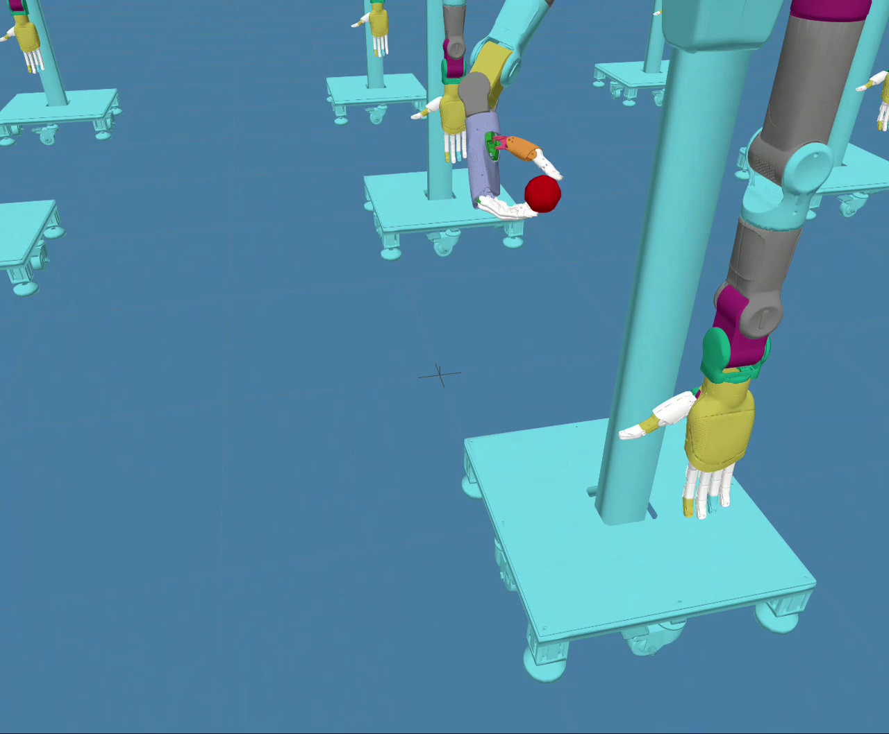

# Physics-v1 成果与 Demo

> 从随机初始位姿出发，让双臂多指机器人完成番茄接近、抓持、脱离和稳定保持；结果、
> checkpoint、训练历史、视频与可达空间数据全部可以在仓库中核对。

## Demo：机器人学会了什么

  

<strong>▶ 点击画面播放完整 36.6 秒 Demo</strong>

视频展示的是同一策略在多个并行 Isaac Sim 环境中的动作。每个环境拥有不同的手臂和
番茄初始位置，策略需要自己完成接近、建立多指支撑、让番茄脱离并继续稳定保持。

<table>
  <tr>
    <td width="50%"></td>
    <td width="50%"></td>
  </tr>
  <tr>
    <td align="center">不同初始位姿下并行执行</td>
    <td align="center">多指手与番茄交互近景</td>
  </tr>
</table>

Demo 用于直观展示动作，不替代统计评测。下面的成功率来自单独运行的固定多种子评测。

## 最终成果

| 指标 | 结果 |
|---|---:|
| 选定模型 | `model_5150.pt` |
| 固定评测成功率 | **85.9715%** |
| 95% Wilson 区间 | 85.4846%–86.4448% |
| 完成 episode | **20,102** |
| 成功 episode | **17,282** |
| 最差种子成功率 | **85.6218%** |
| 三种子差异 | 0.9301 个百分点 |
| drop rate | 6.7804% |

评测固定使用种子 17、42、2026，每个种子 1,024 个环境、400 个仿真步，并采用
deterministic policy。最终 checkpoint 是完整训练状态，不仅有 Actor 权重，还包含
Critic、观测归一化器、策略标准差和优化器，因此可以继续训练，而不只是播放 Demo。

原始目标是 90%，**没有达到**。训练在用户查看曲线后授权停止；85.9715% 是最佳已测试
checkpoint 的固定评测结果，而不是训练曲线峰值。

## 可达空间：策略从哪里开始

  

这张图来自当前 Physics-v1 v3 配置的 **2,048 个真实 USD 前向运动学样本**，seed 为 42：

- 蓝色圆点：机器人手掌的初始位置；
- 橙色叉号：与每个手掌样本配对的番茄初始位置；
- X、Y、Z 分别表示前向、侧向和高度，单位为米；
- 闭合位姿 IK 可达率为 **100%**；
- 最小关节限位余量为 3.81%；
- 最大闭合位置误差约 0.012 mm；
- 初始最大接触力为 **0 N**，说明采样不是从穿模或预碰撞状态开始。

点云生成时没有启动 PPO 训练。原始
[CSV](./assets/physics_v1/physics_v1_reset_workspace_seed42_2048_demo_v3_2048.csv) 和
[JSON](./assets/physics_v1/physics_v1_reset_workspace_seed42_2048_demo_v3_2048.json)
与图片一起发布，可检查每个样本和汇总边界。

## 这项工作的价值

Physics-v1 不只是“让机器人动起来”，而是把以下环节连成了可复现闭环：

1. 让机械臂从连续、可达且无初始碰撞的空间开始；
2. 用多指手形成真实支撑，而不是只靠末端位置碰到番茄；
3. 在 120 Hz 物理仿真中学习接近、抓持、脱离和保持；
4. 用固定种子和数万 episode 做独立评测；
5. 发布完整 checkpoint、配置、训练曲线和评测证据，让其他人可以复核或继续训练。

它仍然是仿真成果，不代表真实机器人已经通过验收。A7 控制响应、真实手部映射、接触摩擦、
番茄品种和感知误差仍需要硬件测量。

<strong>复现与审计入口</strong>

- [最终 iter 5150 训练与复现说明](./PHYSICS_V1_PERF_V7_FINAL_5150.md)
- [最终固定评测 JSON](../../logs/qualification/tomato_physics_v1/convergence_eval_5150_pause/aggregate.json)
- [checkpoint 选择记录](../../logs/qualification/tomato_physics_v1/convergence_report/best_checkpoint_selection.json)
- [训练曲线与自包含报告](../../logs/qualification/tomato_physics_v1/convergence_report/physics_v1_convergence_report.html)
- [Demo 文件清单](./assets/physics_v1/physics_v1_demo_manifest.json)
- [可达空间生成脚本](../../script/plot_tomato_physics_v1_reset_workspace.py)

最终 checkpoint SHA-256：
`655806f86a1bcf9e1472c064a5580523f6d8344d94a04c39f07112dcdcceacb0`。

