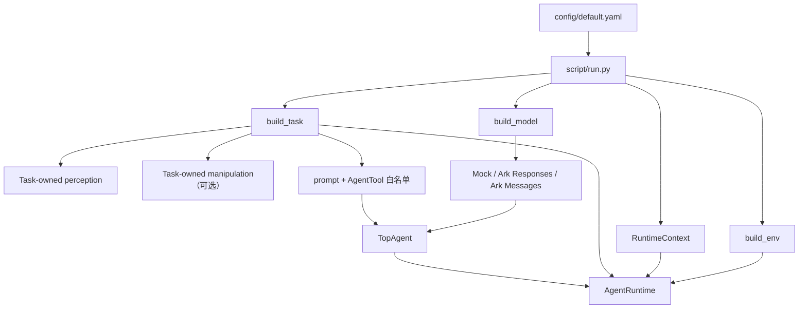
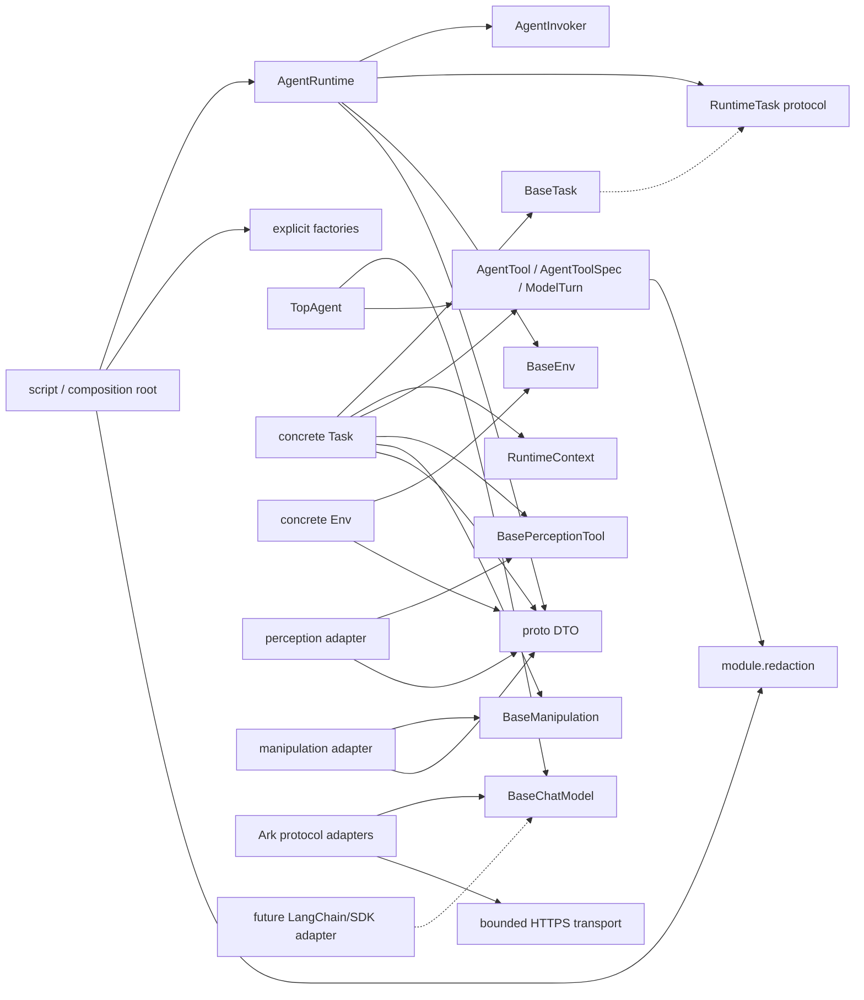

# RealAgent 开发者指南

本文面向准备新增 Task、Env、感知实现、manipulation 后端或模型适配器的开发者。
本文描述当前已经落地的中立 Agent 核心，以及第二阶段的 Ark 双协议模型适配；没有
实现的 SDK、硬件和下游动作不会写成现有能力。

当前实现状态：

- 只有一个 `TopAgent`，Task、Env、感知和 manipulation 都不是第二层 Agent；
- 核心仅依赖 Python 3.11+ 标准库，默认配置使用确定性 mock，离线测试不联网；
- 已实现 `doubao-seed-2.0-pro` 的 Ark OpenAI Responses 和 Anthropic Messages 兼容
  协议，使用标准库 HTTPS，不依赖供应商 SDK；
- 两条真实协议均已通过最小 tool-call 冒烟，凭据只从 `ARK_API_KEY` 读取；
- 已只读审计 `botSDK/`：设备基线为双臂、每臂 7 关节和左右 G20；现有 FK/IK、
  MoveJ/MoveJP/MoveL/FollowP 可作为后续 adapter 底座，MoveC 不可用；
- 番茄采摘 C1 离线层已同步到 V3：66 维可部署 Actor 观测、83 维 privileged critic、
  11 维连续动作、独立 Verifier、`AgriPickTask` 和 5 个工具可用确定性 mock 运行；
- PPO 活动实现已重建为一套最小 MDP：6D 抓取坐标系末端增量 + 5D G20 绝对抓取协同，
  不含阶段机、动作屏蔽、规则抓取、课程、BC、定制动作分布或可循环刷取的 dense reward；
- C2-2A 运行时已完成：独立安装 Isaac Sim 6.0.1 / Isaac Lab 6.1.14 / RSL-RL 5.0.1，
  RTX 5090 CUDA PhysX 及正式双臂/G20 的 71-body/56-DOF USD smoke 均通过；
- 新 DirectRLEnv 已通过 64 环境物理门禁：reset 最小余量 5.15 mm、初始接触力 0、
  6D DLS IK、5D 到 16 关节目标、逐指接触和轴向拉力断梗事件均有效；
- 标准 RSL-RL 5 feed-forward PPO 已通过 256 环境、4 更新、32768 transition 数值门禁，
  loss/std/checkpoint 有限；当前只标记“正式长训前已准备”，尚未启动新的正式训练；
- 已完成 C4-O 离线设备适配边界：LinkBot/G20 gateway 契约、中立状态转换、双臂双手
  生命周期、只读门禁、租约、幂等、急停和四设备部署模板；
- 初态是可达、零接触的局部预抓取分布；PPO 可连续调整末端局部六维位姿与五维手型，
  自行搜索接近、包络、拉/扭断梗和保持；`MockTomatoPickPolicy` 不是训练后的 PPO；
- 旧复杂 PPO、奖励补丁和审计脚本已从当前工作树删除；需要审计时可从 Git 历史追溯，
  SDK 旧 Fruit-Grasp baseline 不被复用；
- Agent 默认运行不加载本地模型权重，不连接仿真器、相机或机器人，也不执行真实
  下游动作；Isaac smoke 只在隔离运行时显式执行，从未连接 vendor SDK/CAN/真机；
- LangChain、RoboTwin、YOLO、SAM、GraspGenX 和常驻 service 仍是后续适配项。进入
  这些 SDK、硬件或动作联调前，必须取得对应版本、接口、授权和安全测试条件。

一句话概括：Runtime 负责“怎么运行”，Task 负责“这次要完成什么”，Env 负责“如何
与世界交互”，`TopAgent` 只在 Task 给定的白名单中完成一次有界的模型/工具往返。

快速入口：第一次阅读看第 1～4 节；判断代码放哪里看第 3、5 节；新增组件看第
6～12 节；提交前看第 13 节；番茄采摘冻结边界看第 14 节。阶段范围与验收项由
[IMPLEMENTATION_PLAN.md](./IMPLEMENTATION_PLAN.md) 追踪。

## 1. 五分钟理解框架

### 1.1 默认组装流程

[script/run.py](./script/run.py) 是 composition root。它读取根配置及模型、感知
profile，按显式 Factory 组装单次运行需要的对象；它不包含具体任务分支。



当前模型 Registry 显式暴露 `mock`、`ark_openai_responses` 和
`ark_anthropic_messages`；Env、通用 perception/manipulation 和 C1 robotics/skill/task
组件当前只注册 `mock`，Task 为 `locate_target | agri_pick`。模型配置和凭据在 Env/Task
资源创建前校验；之后若组装失败，入口会
关闭已经创建的 Task 和 Env。

### 1.2 两层有界循环

系统有两层职责不同的循环：

1. 外层由 `AgentRuntime` 管理。它负责 `reset`、当前观测、控制步上限、Task 完成
   判断和统一清理，最多执行 `runtime.max_steps` 次 Agent 调用。
2. 内层由 `TopAgent` 管理。一次 `invoke()` 内可以进行多轮“模型返回 `ModelTurn` →
   `TopAgent` 执行 `AgentTool` → 把结果交回模型”。它同时受模型轮次、单次 tool 总数
   和单轮 tool 数量三个上限约束。

Runtime 依赖结构化的 `AgentInvoker` 和 `RuntimeTask` 协议，而不是依赖某个 Agent
框架或具体 Task 包。当前
`TopAgent`、`AgentTool`、只读 `AgentToolSpec`、`ToolCall` 和 `ModelTurn` 都是标准库
实现的中立契约。模型适配器只收到不含可执行 handler 的 `AgentToolSpec`。该 spec
包含 `name`、`description` 和只读 object JSON schema `parameters`；schema 可显式提供，
也可从可信 handler 签名保守推断，并受结构、敏感字段和编码体积校验。
LangChain 只是未来可能实现 `BaseChatModel` 或 `AgentInvoker` 适配器的一种选择，当前
代码和测试没有 LangChain 依赖。

### 1.3 一次默认运行

```text
AgentRuntime.run()
  -> env.reset()，返回值直接成为首帧
  -> context.update_observation(first_observation)
  -> task.run(runtime)
       -> runtime.run_default()
            -> 对每个 control step：
                 task.build_input(current_observation)
                 agent.invoke(...)
                   -> model.invoke(...)
                   -> 执行本 Task 白名单中的 AgentTool
                   -> 追加 tool result，可能继续下一模型轮次
                 task.is_complete(context, agent_result)
                 未完成且还有下一步时，按刷新规则取得下一帧
            -> 返回 RuntimeReport
  -> finally: task.close()
  -> finally: env.close()
```

### 1.4 `TopAgent.invoke()` 的明确语义

`AgentInvoker.invoke()` 接收包含 `messages` 序列的 mapping。`TopAgent` 每次调用都新建
局部 transcript，并先调用 `model.reset()`；它不会自动拼接上一个外层 step 的消息，
因此当前没有跨 step 对话记忆。若将来需要记忆，必须新增显式、可测试的状态所有者，
不能悄悄改变这一契约。

一次调用正常返回的字典固定包含：

- `messages`：本次调用的安全化 transcript；
- `output`：最后一个 assistant turn 的内容；
- `stop_reason`：模型给出的终止原因，省略时为 `completed`；
- `iterations`：本次实际消耗的模型轮次。

`max_iterations` 计算模型轮次，不计算单独的 tool 数量。到达上限时，Agent 在执行完
该轮已请求的 tool 后返回 `stop_reason="max_iterations"`，不会继续调用模型，也不会
伪造终态回答。`max_tool_calls` 限制单次 invoke 的 tool 总数，
`max_tool_calls_per_turn` 限制一个 `ModelTurn` 中的 tool 数；超额的当前轮在任何 handler
执行前抛出 `ToolCallLimitError`。Task 仍然只按可验证工具结果判断任务是否完成。
随仓默认值依次为 4、4、2。

失败分为四类：

- 未知 tool 会生成 `status="error"`、`type="unknown_tool"` 的 tool message；
- tool 参数无法绑定 handler 签名时会变成 `RecoverableToolError`；Task wrapper 对空检测、
  空候选等预期语义失败也应显式抛出 `RecoverableToolError`。这类失败记录 WARNING 级
  error tool message，下一模型轮次可以恢复；
- handler 的其他异常属于意外基础设施或编程错误，直接向 Runtime 传播，不能让模型
  在未知状态下继续；tool 数量超限的 `ToolCallLimitError` 同样直接传播；
- 非法输入、模型返回非 `ModelTurn`、模型适配器基础设施异常等边界错误继续抛出，由
  Runtime 清理后交给调用者，不会转换成成功结果。

tool 名在构造 `TopAgent` 时必须唯一。Agent 只能调用 Task 传入的 `AgentTool`；项目中
不存在全局 Agent tool 仓库。`ModelTurn` 还带有每轮 64 个 tool call 的绝对硬上限，
防止模型适配器构造无界对象；实际运行通常由更小的配置预算先拒绝。

### 1.5 `RuntimeReport` 与观测刷新

正常结束返回 `RuntimeReport`：

|字段|语义|
|---|---|
|`completed`|只有 `reason` 为 `TASK_COMPLETE` 时才为 `True`|
|`reason`|`TASK_COMPLETE` 或 `STEP_LIMIT`|
|`control_steps`|实际执行的外层 Agent 调用数|
|`last_observation_sequence`|结束时上下文中的观测序号|
|`last_agent_result`|最后一次小型、安全化的 Agent 结果；尚未调用时可为 `None`|

`RuntimeReport` 在构造时严格校验 `completed`、`CompletionReason`、两个非负整数和
`last_agent_result` mapping，并要求 `completed` 与 reason 一致；最后结果会复制成
只读 mapping，避免调用方后改。

步数耗尽是正常的未完成结果：`completed=False`、`reason=STEP_LIMIT`。不可恢复异常不
返回 `RuntimeReport`，而是在清理后继续抛出。Runtime 是 single-use：第一次运行后
状态变为 `CLOSED`，第二次 `run()` 会立即失败，也不会再次清理资源。

若 composition caller 组装了 Runtime 后决定不运行，可以在 `READY` 状态显式调用
`runtime.close()`：它按 Task、Env 顺序清理并转为 `CLOSED`，重复调用无操作；运行中
调用 `close()` 会被拒绝，避免与同步 `run()` 的资源所有权竞争。

刷新规则必须保持精确：

1. `env.reset()` 返回的观测就是控制步 1 的首帧，不立即调用 `get_obs()`；
2. `RuntimeContext.update_observation()` 原子替换整帧，并递增
   `observation_version`；tool 每次从 `require_observation()` 读取最新帧；
3. 自定义 flow 调用 `runtime.step(action)` 时，默认即刻执行一次 `observe()`；即使
   `Result.success` 为 `False` 也刷新，因为被拒绝或部分执行的动作仍可能改变世界；
4. 若 Env 在 `take_action()` 中抛出基础设施异常，则异常继续传播，不制造假 Result；
5. 外层记录 Agent 调用前的观测版本。若 tool 已推进版本，步边界不重复采集；否则只
   在“当前步未完成且还有下一步”时调用一次 `get_obs()`；
6. 完成条件已经成立或已到最后一步后，不获取没有消费者的额外观测；
7. `runtime.step(..., refresh_observation=False)` 只有在调用方明确管理后续刷新时使用。

## 2. 设计思想与哲学

### 2.1 最小公共核心

公共 Runtime 只保留所有任务都需要的控制逻辑。新任务增加时，Runtime 的分支数量不
应随之增长。

当前核心对象是：

- `RuntimeContext`：保存 Env、最新 `Observation` 和单调递增的观测版本；
- `RuntimeTask`：Runtime 就地定义的结构化 Task 边界，避免运行时导入 Task 包；
- `AgentRuntime`：管理 single-use 生命周期、外层有界循环、`observe()` 和 `step()`；
- `RuntimeReport`：表达正常完成或步数耗尽，不承载大体积传感器数据。

项目不引入全局依赖注入容器、自动目录扫描、通用节点树或全局工具仓库。只有多个已
实现任务出现稳定的相同需求时，才把能力上提为公共抽象。

### 2.2 Task 拥有任务语义

Task 是任务语义的唯一所有者。它决定：

- system prompt；
- 完整 Agent tool 白名单；
- 如何把 `Observation` 转为小型 Agent 输入；
- 什么可验证结果表示任务完成；
- 使用默认循环还是覆盖 `run(runtime)`；
- 需要哪些 perception 和 manipulation 实例。

任务专属 prompt、几何计算、工具组合和特殊流程放在 `task/<task_name>/`。Runtime、
Env 和 Agent 不应知道物体名称、步骤顺序或完成条件。

### 2.3 Env 只表达世界能力

Env 是 Runtime 与外部世界之间的最小适配边界：

- `reset(seed) -> Observation`；
- `get_obs() -> Observation`；
- `take_action(Action) -> Result`；
- `close() -> None`。

Env 不选择感知模型，不编写 prompt，不判断任务完成，也不能用仿真 ground truth
绕过任务要求的视觉感知。当前只有 `MockEnv`：它回放配置观测、记录动作，并能确定性
模拟动作拒绝或基础设施异常。

### 2.4 依赖稳定契约，不依赖具体后端

跨模块数据使用 [proto/](./proto/) 中的中立 DTO：`Observation`、`Action`、
`Result`、`VisionInstance`、`VisionResult`、`Pose` 和 `GraspCandidate`。核心依赖
`BaseEnv`、`RuntimeTask`、`BasePerceptionTool`、`BaseManipulation`、`BaseChatModel`、
`AgentInvoker` 和 `ModelTurn`；具体任务以 `BaseTask` 实现并结构化满足 `RuntimeTask`，
不依赖供应商 SDK 类型。

DTO 字段通过名称明确单位和顺序，例如 `depth_m`、`joint_positions_rad`、
`position_m` 和 `quaternion_wxyz`。传感器 payload 可以在 `Observation` 中保持不透明，
但活的 SDK client 或资源所有者不能塞进 DTO。

### 2.5 配置负责选择，代码负责行为

配置只描述“选择哪个显式注册的实现”和“传入哪些构造参数”。它不保存运行时状态，
不执行 Python 逻辑，也不替代类的职责。

Factory 使用显式 Registry，不扫描目录。新增类型需要明确导入并注册，这让合法名称、
构造入口和错误信息可以直接检查和测试。composition root 会在获取 Env/Task 资源前
校验根字段、profile、Registry 类型、构造参数和循环上限；无效配置应在零资源获取时
失败。模块 import 阶段不得连接外部系统或加载权重。

### 2.6 Agent 只获得最小能力

`Task.build_tools(context)` 返回的列表就是当前任务的完整能力白名单。最小授权带来
四个直接结果：

- 模型看不见无关能力；
- Task 决定是否暴露可能改变世界的操作；
- 测试可精确断言 tool 名集合；
- 新增公共后端不会自动改变已有 Task 的行为。

Agent transcript 会经过有界 JSON-safe 转换：二进制只保留字节数，集合大小、字符串
长度和嵌套深度受限，常见秘密字段、Authorization/Bearer、带空格/转义/多行的引号
凭据会脱敏。非字符串 mapping key 使用不透明序号，不调用调用方的 `str()`/`repr()`；
未知对象也只记录类型。消息和日志共用 `module.redaction`，避免两套规则漂移。模型
适配器只看到不可执行的 `AgentToolSpec(name, description, parameters)`，handler 始终
留在 `TopAgent` 的白名单映射中。`parameters` 的冻结副本防止供应商适配器修改 Task 的
原始 schema。

### 2.7 资源由创建者管理

- Env 创建的环境资源由 `env.close()` 释放；
- Task 通过配置创建的 manipulation 和 perception 都由 `task.close()` 释放；
- `BaseTask.close()` 先按逆序关闭 manipulation，再按逆序关闭 perception；
- Runtime 在所有正常和异常路径上都先尝试 `task.close()`，再尝试 `env.close()`；
- 尚未运行的 `READY` Runtime 可由调用方显式 `close()`，同样释放 Task 和 Env；
- 某个清理失败不会阻止后续清理；主异常和清理异常按发生顺序用 Python 3.11
  `BaseExceptionGroup` 聚合；
- `close()` 是幂等的单次尝试：首次进入就标记 closed，再调用子资源或 adapter hook；
  即使首次清理报告部分失败，重复 `close()` 也不能再次释放同一资源；
- 一个 close hook 应在一次调用内尽可能释放全部自有资源，再报告聚合错误；部分构造
  失败的组件同样必须回收已经创建的依赖。

Runtime 不知道具体资源是模型、相机还是网络连接。当前 mock 的 `close()` 同样实现并
测试这一契约，不能因为“没有真实资源”就跳过生命周期设计。

### 2.8 重依赖隔离在适配器边界之后

下表区分已经落地的轻量协议适配和仍未实现的重依赖：

|后续项|当前状态与边界|
|---|---|
|RoboTwin 或真机 Env|未实现；后续只能在 Env 适配器内接入 SDK|
|YOLO、SAM 和真实权重|未实现；后续在 perception 适配器内转换为中立 DTO|
|GraspGenX|未实现；后续在 manipulation 适配器内转换为 `GraspCandidate`|
|perception/manipulation service|未实现；当前无 client、协议、进程管理或配置字段|
|Ark 兼容模型协议|已实现标准库 HTTPS 适配；仅模型层感知供应商 JSON|
|LangChain 或供应商模型 SDK|未引入；若后续采用，只能在中立模型/Invoker 契约之后适配|
|LinkBot/G20 离线适配|已实现 gateway 契约、DTO 转换、左右 G20 独立生命周期、部署槽位和 fake gateway 测试；未导入 vendor SDK|
|真实运动、抓取和末端执行器动作|未接入；vendor gateway、最终 endpoint、标定、shadow 和单命令验收仍需真机环境|

通用 Runtime 和 Task 不切换工作目录、不修改 `sys.path`、不启动第三方进程。默认
单元测试不联网、不下载资源、不启动 GPU，也不读取凭据。Ark 真实 API 冒烟是显式、
独立运行的测试，不属于默认单元测试。进入尚未实现的 Env、感知、manipulation 或
动作 SDK 联调点时，必须先取得必要信息、授权和安全测试条件。

### 2.9 默认可观测，但日志不改变业务逻辑

库模块使用 `logging.getLogger(__name__)`，只有 CLI 入口配置 handler。一次 CLI 运行
在指定目录创建独立日志文件：控制台显示简短 INFO/错误摘要且主动移除 traceback，
文件保留经过脱敏的 DEBUG 细节和完整异常堆栈。日志目录或 handler 初始化失败时，
入口恢复原有 logger 状态，向 stderr 输出已脱敏的一行摘要并返回 1，不进入 Runtime。

日志不得成为组件通信通道，也不得记录原始 RGB bytes、完整 mask、点云、权重或
秘密。入口和 Agent 层均有脱敏/有界转换，但这不是在上游随意传大对象或凭据的理由。

## 3. 目录与职责

|路径|当前负责什么|不负责什么|
|---|---|---|
|[module/runtime.py](./module/runtime.py)|上下文、`RuntimeTask` 协议、刷新、外层循环、报告和清理|具体 Task、模型选择、后端初始化|
|[module/agent/](./module/agent/)|中立 Agent 契约与 `TopAgent` 内层循环|环境控制步、Task 完成条件、跨 step 记忆|
|[module/agent/models/](./module/agent/models/)|`BaseChatModel`、mock、Ark 双协议 adapter、安全 HTTPS transport、显式 Registry|prompt、机器人状态、下游动作|
|[module/redaction.py](./module/redaction.py)|消息与日志共享的纯文本凭据脱敏|鉴权、密钥存储、业务数据传递|
|[module/tools/env/](./module/tools/env/)|`BaseEnv`、`MockEnv` 和 Env Factory|Task 目标、感知选择、prompt|
|[module/tools/perception/](./module/tools/perception/)|Observation-based 感知契约、mock 和 Factory|真实 YOLO/SAM、全局 Agent tool|
|[module/tools/manipulation/](./module/tools/manipulation/)|抓取候选契约、mock 和 Factory|真实 GraspGenX、动作执行、Agent tool 暴露|
|[proto/](./proto/)|不可变、后端无关 DTO|活的 SDK 对象、业务流程|
|[task/](./task/)|prompt、tool 组合、输入、完成条件、Task 资源|通用 Runtime、隐式后端发现|
|[config/](./config/)|根配置、模型与感知 profile|密钥、对象实例、运行结果|
|[script/](./script/)|composition root、CLI、配置加载和日志配置|可复用任务语义|
|[tests/](./tests/)|离线契约、fake provider、架构、组装和运行时测试|公网、GPU、真机或付费 API 的自动测试|

### 3.1 当前支持的扩展契约

优先从包级公开入口导入：

- `module.agent`：`AgentInvoker`、`AgentTool`、`AgentToolSpec`、`ToolCall`、`ModelTurn`、
  `RecoverableToolError`、`ToolCallLimitError`、`BaseChatModel`、`TopAgent`、model
  Factory/Registry、Ark adapters 及 provider 错误契约；
- `module.tools.env`：`BaseEnv`、`MockEnv`、Env Factory/Registry；
- `module.tools.perception`：`BasePerceptionTool`、`MockPerceptionTool`、perception
  Factory/Registry；
- `module.tools.manipulation`：`BaseManipulation`、`MockManipulation`、manipulation
  Factory/Registry；
- `module.redaction`：消息和日志共同使用的 `redact_text()`；
- `proto`：全部中立 DTO；
- `task`：`BaseTask`、Task Factory/Registry；
- `module.runtime`：`RuntimeTask`、`RuntimeContext`、`AgentRuntime`、`RuntimeReport`、
  状态和停止原因。

以下划线开头且未由包级 `__init__.py` 导出的对象默认是内部实现。修改任一公共契约、
DTO 或配置语义都需要架构评审和契约测试。

## 4. 依赖方向



必须避免的反向依赖：

- Runtime 导入 Task 包、具体 Task、RoboTwin、YOLO、SAM 或 GraspGenX；
- Agent 层导入 Runtime、Task 或具体 Env；
- Env 导入 Task 或 Agent；
- perception/manipulation 导入 Runtime、Task 或 Agent；
- 公共模块导入某个任务目录中的专属实现；
- Task 直接操作供应商全局进程、工作目录或模块搜索路径。

## 5. 修改权限：哪里可以改，哪里需要评审

### 5.1 普通功能开发可以直接修改

在不改变公共契约的前提下，可以：

- 新建 `task/<new_task>/` 并显式注册；
- 在相应能力目录新增一个 SDK-neutral 适配器和 Registry 项；
- 新增 JSON-compatible YAML profile 或任务配置；
- 新增针对性离线测试和文档；
- 修改新增组件的私有辅助函数。

一次变更应完成一个清晰目标，不夹带无关格式化、重命名或全仓重构。

### 5.2 修改前必须进行架构评审

|区域|为什么需要评审|
|---|---|
|`module/runtime.py`|影响所有 Task 的执行、刷新、报告和清理|
|`task/_base_task.py`|影响 Task 契约、依赖创建和关闭顺序|
|任一 `Base*` 或 Agent 中立契约|影响全部具体实现和模型/tool 协议|
|`proto/` DTO|影响 Env、Task、适配器和测试的数据边界|
|Factory/Registry 的参数语义|可能让已有配置失效|
|`script/utils/config_utils.py`|影响全部配置文件的读取规则|
|`module/agent/agent.py`|影响工具失败、上限和 transcript 语义|
|`module/redaction.py`|影响 Agent message 与全部运行日志的秘密清理边界|
|包级公开导出|删除或重命名会破坏现有 import|
|`pyproject.toml` 依赖或 Python 版本|影响离线核心和所有安装环境|

评审说明至少回答：现有契约为何不足、哪些实现和配置受影响、是否需要迁移层、如何
测试兼容性，以及文档如何同步。

### 5.3 禁止的做法

- 在配置、源码、日志或测试 fixture 中提交密钥、token、密码或私有服务凭据；
- 把 Task prompt、目标、步骤顺序或完成条件写进 Runtime；
- 用仿真 ground truth 绕过要求的视觉感知；
- 自动扫描目录并隐式注册；
- 在 import 阶段下载权重、启动 service、读取凭据或连接设备；
- 每次 tool 调用都重新加载模型；
- 在公共代码中修改进程级 cwd、`sys.path` 或环境变量；
- 捕获异常后静默继续，或把失败转换为伪成功；
- 把大数组、二进制 payload、完整 mask/点云或权重写入 Agent message；
- 让默认测试依赖公网、GPU、仿真器、真实机器人或真实模型；
- 在功能变更中夹带无关重构。

## 6. 开发一个新 Task

### 6.1 文件结构

```text
task/my_task/
├── __init__.py
├── task.py
├── geometry.py          # 可选：纯几何算法
└── config/              # 可选：任务专用配置
```

只有至少两个已实现任务使用相同任务语义且输入输出稳定时，才考虑把任务专属代码上提
到公共目录。第 14 节规划的 `module/robotics` 不承载番茄流程，而是已经由设备仓证明、
且需要 mock/Isaac/LinkBot 三种后端共同实现的硬件能力边界；它仍须通过公共契约评审
和离线测试，不能借此把番茄完成条件上提到 Runtime。

### 6.2 实现最小契约

下面示例使用当前中立 `AgentTool`，不依赖 LangChain：

```python
from __future__ import annotations

from typing import Any, Mapping

from module.agent import AgentTool, RecoverableToolError
from module.runtime import RuntimeContext
from proto import Observation
from task._base_task import BaseTask


class MyTask(BaseTask):
    def __init__(self, *, target: str) -> None:
        if not isinstance(target, str) or not target.strip():
            raise ValueError("target must be a non-empty string")
        self._target = target.strip()
        super().__init__()

    def build_prompt(self) -> str:
        return (
            f"Locate {self._target!r} with locate_target. "
            "Do not report completion before the tool succeeds."
        )

    def build_tools(self, context: RuntimeContext) -> list[AgentTool]:
        detector = self.get_perception_tool("target_detector")

        def locate_target() -> Mapping[str, Any]:
            """Locate the configured target in the latest observation."""

            observation = context.require_observation()
            result = detector.run(observation, labels=[self._target])
            if not result.instances:
                raise RecoverableToolError(f"no {self._target!r} was found")
            return result.as_dict()

        return [
            AgentTool(
                name="locate_target",
                description=(
                    "Locate the configured target in the latest observation; "
                    "success requires at least one matching instance."
                ),
                handler=locate_target,
            )
        ]

    def build_input(self, observation: Observation) -> Mapping[str, Any]:
        return {
            "messages": [
                {
                    "role": "user",
                    "content": (
                        "A fresh observation is available at sequence "
                        f"{observation.sequence}. Use only allowed tools."
                    ),
                }
            ]
        }

    def is_complete(
        self,
        context: RuntimeContext,
        agent_result: Mapping[str, Any],
    ) -> bool:
        del context
        messages = agent_result.get("messages", [])
        if not isinstance(messages, list):
            return False
        return any(
            isinstance(message, Mapping)
            and message.get("role") == "tool"
            and message.get("name") == "locate_target"
            and message.get("status") == "success"
            for message in messages
        )
```

实现要求：

- 构造函数只接收任务参数，并调用 `super().__init__()`；
- `build_prompt()` 写目标、约束和可验证完成条件；
- `build_tools()` 只返回当前任务允许的能力；
- tool 从 `RuntimeContext.require_observation()` 读取当前帧，不闭包捕获旧帧；
- `build_input()` 不复制图像、mask 或点云；
- `is_complete()` 不依据模型一句“完成”，也不把 error tool message 当成功；
- 空检测、空候选等模型可恢复的语义失败必须抛出 `RecoverableToolError`；意外后端异常
  保持原类型并向 Runtime 传播；
- 固定流程可覆盖 `run(runtime)`，但应复用 Runtime 的状态、刷新和报告语义。

### 6.3 声明 perception 与 manipulation

Task 构造函数不接收具体 SDK 对象，也不自行读取配置。`BaseTask.from_config()` 解析
`perception_tools` 和 `manipulation_tools`，创建实例并登记所有权：

```yaml
task:
  type: my_task
  target: bottle
  perception_tools:
    - name: target_detector
      profile: offline_mock
  manipulation_tools:
    - name: grasp_planner
      type: mock
```

Task 通过稳定语义名称取实例：

```python
detector = self.get_perception_tool("target_detector")
planner = self.get_manipulation_tool("grasp_planner")
```

`name` 是 Task 代码依赖的名称；perception 的 `profile` 从
[config/_perception.yaml](./config/_perception.yaml) 解析；manipulation 当前直接按
`type` 构建。当前两类可运行实现都只有 `mock`。Task 关闭时两类依赖都会关闭；如果
依赖构造中途失败，已经创建的实例也会被回收。

### 6.4 注册和测试

1. 在 `task/my_task/__init__.py` 导出类。
2. 在 [task/factory.py](./task/factory.py) 显式导入并调用 `register_task()`。
3. 增加配置和针对性测试。
4. 至少覆盖 Factory、精确 tool 白名单、最新观测、成功/失败完成条件、依赖关闭和
   自定义 flow 生命周期。

未注册的目录只是源码，不代表 CLI 已支持该任务。

## 7. 开发一个 AgentTool

当前公共 tool 是 `AgentTool(name, description, handler, parameters=None)`。它没有
LangChain decorator，也不会自动进入全局仓库。`ToolCall.arguments` 会复制为 mapping，
并通过关键字参数调用 handler；模型适配器只会拿到由它生成的 `AgentToolSpec`，无法
访问或执行 handler。spec 包含受校验的 object JSON schema：省略 `parameters` 时会从
可信 Python 签名保守推断，也可以显式传入更精确的 schema。

规范如下：

- 名称必须匹配小写 `snake_case`，以字母开头，例如 `locate_target`；
- description 非空，说明何时调用、做什么以及何为成功；
- `parameters` 根必须为 object schema；`properties`、`required` 和
  `additionalProperties` 会在构造边界校验，整体编码大小不超过 65,536 bytes；
- tool 参数名不得使用 key、token、password、authorization 等凭据语义；秘密不应成为
  模型参数，即使调用方另有脱敏；
- handler 参数使用精确类型，单位和坐标系写进名称或 description；
- 返回小而稳定的 mapping，只包含模型下一步需要的数据；
- 不把 `Observation`、图片、depth、mask 或点云作为模型可见参数；
- 预期由模型修正的参数/语义失败抛出 `RecoverableToolError`，使 transcript 得到 error
  tool message；权限、设备、网络、断言等意外异常保持原样传播；
- Task wrapper 决定暴露什么，底层 capability 不自行暴露 Agent tool。

示例：

```python
def summarize_pose(frame_id: str) -> dict[str, str]:
    """Return a small pose summary for the requested coordinate frame."""

    return {"frame_id": frame_id, "status": "available"}


pose_tool = AgentTool.from_callable(
    summarize_pose,
    name="summarize_pose",
    parameters={
        "type": "object",
        "properties": {"frame_id": {"type": "string"}},
        "required": ["frame_id"],
        "additionalProperties": False,
    },
)
```

`AgentTool.from_callable()` 可从函数名和 docstring 推断默认值；缺少非空 description
会在构造时失败。schema 和 `as_dict()` 返回值都与调用方可变对象隔离。参数无法绑定
handler 签名时，`AgentTool.invoke()` 会在调用 handler 前产生可恢复错误。不要用
`RecoverableToolError` 包装未知基础设施异常。

当前内置 Task 有读取观测的 `locate_target` 和离线 `agri_pick`。后者只暴露 5 个任务级
工具，并通过 `TomatoPickService` 调用 mock Ports/Skill/Verifier；它不是机器人 SDK
接入。`AgentRuntime.step()` 目前供自定义 Task flow 和后续动作 wrapper 使用。

## 8. 开发一个新 Env

### 8.1 实现 `BaseEnv`

```python
from module.tools.env import BaseEnv
from proto import Action, Observation, Result


class MyEnv(BaseEnv):
    def reset(self, seed: int | None = None) -> Observation:
        ...

    def get_obs(self) -> Observation:
        ...

    def take_action(self, action: Action) -> Result:
        ...

    def close(self) -> None:
        ...
```

职责要求：

- 在适配器边界把 SDK 对象转换为中立 DTO；
- 在 docstring 中明确 RGB/depth/joint 的 shape、dtype、单位和坐标系；
- `reset()` 返回稳定后的第一帧；
- `take_action()` 只执行通用命令，不解释 Task 目标；
- 被后端拒绝的命令返回 `Result(success=False, ...)`，传输/设备异常继续抛出；
- `close()` 首次调用即标记已尝试并尽量释放全部自有资源；首次失败后重复调用也不能
  再次触碰同一资源；
- 可选依赖延迟 import，未选择该 Env 时不要求安装 SDK。

当前 `BaseEnv` 没有 `build_action_tools()` 契约。不要在公共 Env 中自动暴露所有动作；
真实动作接入需要单独设计 Task wrapper、刷新和安全边界。

### 8.2 注册和测试

在 [module/tools/env/factory.py](./module/tools/env/factory.py) 的 `ENV_REGISTRY` 显式
注册 builder。测试至少覆盖 reset 首帧、观测递进、动作成功/拒绝/异常、配置错误和
幂等 close。真实 RoboTwin/真机 smoke test 属于后续联调，不进入默认离线测试。

## 9. 开发一个感知工具

### 9.1 当前边界

当前目录只有通用基类、一个 metadata-driven mock 和显式 Factory：

```text
module/tools/perception/
├── _base.py
├── mock.py
├── factory.py
└── __init__.py
```

公共契约是 `BasePerceptionTool.run(observation, options=None, **overrides)`。输入是完整的
中立 `Observation`，不是预先承诺的 NumPy RGB array；具体适配器自行读取需要的字段并
在边界内归一化。输出必须是 `VisionResult`。

`MockPerceptionTool` 从 `Observation.metadata["detections"]` 读取数据，支持
`labels`、`min_score`/`threshold` 和 `max_instances`，用于离线开发与测试。YOLO、SAM、
detector/segmenter pipeline 和 service 目录当前都未实现，属于后续工作。

### 9.2 继承 `BasePerceptionTool`

```python
from typing import Any

from module.tools.perception import BasePerceptionTool
from proto import Observation, VisionInstance, VisionResult


class MyPerception(BasePerceptionTool):
    def __init__(self, *, name: str = "my_perception") -> None:
        super().__init__(name)
        self._model = None  # 后续适配器可在这里持有已初始化资源

    def _run(
        self,
        observation: Observation,
        options: dict[str, Any],
    ) -> VisionResult:
        threshold = float(options.pop("threshold", 0.25))
        self._reject_options(options)

        instances: tuple[VisionInstance, ...] = ()
        return VisionResult(
            model=self.name,
            instances=instances,
            observation_sequence=observation.sequence,
        )

    def _close(self) -> None:
        self._model = None
```

必须遵守：

- 普通实现只覆盖 `_run()`，不要绕过 `run()` 的类型、计时和序号校验；
- 从复制后的 options 中 `pop` 已支持项，再调用 `_reject_options()`；
- 供应商结果在边界内转换为 `VisionInstance`/`VisionResult`；
- 权重只在实例初始化时加载，不在每次 `_run()` 中加载，import 时不得下载；
- `run()` 会补齐 `elapsed_s` 和输入 `observation_sequence`；
- `BasePerceptionTool` 当前明确具有幂等 `close()`，需要资源清理时覆盖 `_close()`；基类
  在 hook 前标记 closed，hook 首次失败后也不会再次调用；
- 异常继续抛出，不能把推理失败伪装成空检测。

### 9.3 注册和配置

在 [module/tools/perception/factory.py](./module/tools/perception/factory.py) 的
`PERCEPTION_REGISTRY` 注册实现；在 [config/_perception.yaml](./config/_perception.yaml)
增加 profile，然后由 Task 的 `perception_tools` 选择。当前 Registry 只有 `mock`，
随仓 profile 只有 `offline_mock`。尚不存在 detector、segmenter、pipeline 或 service
专用 Registry，不要在配置中使用未实现字段。

## 10. 开发一个 manipulation 后端

### 10.1 当前公共契约

`BaseManipulation` 是 SDK-neutral 抓取候选能力，不是 Agent tool。公共方法为：

```python
def rank_grasp_candidates(
    self,
    observation: Observation,
    *,
    options: Mapping[str, Any] | None = None,
    **option_overrides: Any,
) -> tuple[GraspCandidate, ...]:
    ...
```

它接收 `Observation`，调用实现层 `_rank_grasp_candidates()`，验证 DTO 类型并按 `score`
降序返回。公共 API 不向模型暴露 depth、intrinsics、extrinsics、mask 或点云等大数组，
也不提供 `ranked_grasp_candidates_tool` 属性。

当前 `MockManipulation` 从 `Observation.metadata["grasp_candidates"]` 读取候选，支持
`min_score` 和 `max_candidates`，并实现幂等 `close()`。GraspGenX、远程规划 service、
进程探活和真实点云处理均未实现。

### 10.2 实现与 Task 包装

新后端覆盖 `_rank_grasp_candidates()`，返回中立 `GraspCandidate`；若持有资源则覆盖
`_close()`。基类在 hook 前标记 closed，因此 hook 即使失败也只尝试一次：

```python
from typing import Any

from module.tools.manipulation import BaseManipulation
from proto import GraspCandidate, Observation


class MyManipulation(BaseManipulation):
    def __init__(self, *, name: str = "my_manipulation") -> None:
        super().__init__(name)
        self._client = None

    def _rank_grasp_candidates(
        self,
        observation: Observation,
        options: dict[str, Any],
    ) -> tuple[GraspCandidate, ...]:
        self._reject_options(options)
        return ()

    def _close(self) -> None:
        self._client = None
```

需要让 Agent 使用时，由具体 Task 把当前观测和后端调用封装为小型 `AgentTool`：

```python
planner = self.get_manipulation_tool("grasp_planner")


def plan_grasp(max_candidates: int = 3) -> dict[str, Any]:
    """Return a small ranked grasp summary from the latest observation."""

    if (
        isinstance(max_candidates, bool)
        or not isinstance(max_candidates, int)
        or not 1 <= max_candidates <= 3
    ):
        raise RecoverableToolError("max_candidates must be an integer from 1 to 3")
    observation = context.require_observation()
    candidates = planner.rank_grasp_candidates(
        observation,
        max_candidates=max_candidates,
    )
    if not candidates:
        raise RecoverableToolError("no grasp candidate was found")
    return {
        "observation_sequence": observation.sequence,
        "candidates": [item.as_dict() for item in candidates],
    }


grasp_tool = AgentTool(
    name="plan_grasp",
    description="Return up to three ranked grasp poses for the latest observation.",
    handler=plan_grasp,
)
```

Task wrapper 不接受模型上传的大数组；它从 `RuntimeContext` 取当前观测，只返回必要的
候选摘要，并把非法小参数或空候选标成可恢复语义失败。示例假定当前 Task 模块已经从
`module.agent` 导入 `AgentTool` 和 `RecoverableToolError`。任务步骤顺序和是否暴露该
tool 仍由 Task 决定。

在 [module/tools/manipulation/factory.py](./module/tools/manipulation/factory.py) 的
`MANIPULATION_REGISTRY` 显式注册。当前配置直接使用 `task.manipulation_tools[].type`，
没有 `_manipulation.yaml` profile 文件。

## 11. 开发一个 Agent 模型适配器

### 11.1 当前模型层

所有模型都实现同一个 `BaseChatModel` 中立契约：

```python
from abc import ABC, abstractmethod
from collections.abc import Mapping, Sequence
from typing import Any

from module.agent import AgentToolSpec, ModelTurn


class BaseChatModel(ABC):
    def reset(self) -> None:
        ...

    @abstractmethod
    def invoke(
        self,
        messages: Sequence[Mapping[str, Any]],
        tools: Sequence[AgentToolSpec],
    ) -> ModelTurn:
        ...
```

`MockChatModel` 按配置的 `tool_sequence` 每轮发出一个 `ToolCall`，然后返回
`final_output`；每次 `TopAgent.invoke()` 前都会 reset 并从序列起点开始。
`MODEL_REGISTRY` 还显式注册：

- `ark_openai_responses`：调用 Base URL 下的 `/responses`。首轮发送
  `model/input/instructions/tools/store`，续轮发送新的 `function_call_output` 并通过
  `previous_response_id` 关联状态；响应中的 `function_call` 转为中立 `ToolCall`；
- `ark_anthropic_messages`：调用 Base URL 下的 `/v1/messages`，转换
  `system/messages/tools`；`tool_use` 转为 `ToolCall`，本地 tool message 转为
  `tool_result`，同一轮的并行结果合并为一个 user turn。

两者都使用 `AgentToolSpec(name, description, parameters)` 生成供应商 function schema，
不能接触本地 handler。关键字段缺失或类型错误会抛出 `ProviderProtocolError`，不会
猜测或伪造终态。

### 11.2 传输、凭据与扩展原则

`JsonTransport` 是可注入边界：单元测试使用 fake transport，生产默认使用
`UrllibJsonTransport`。生产 transport 只接受 HTTPS，拒绝 URL 内凭据和 Base URL 的
query/fragment，限制 timeout、请求 JSON 和响应体大小，并把 HTTP、网络和畸形 JSON
错误包装为安全的 provider 异常。错误摘要经过有界提取与脱敏，不记录请求 header 或
payload。

adapter 构造参数只保存凭据环境变量名，默认 `ARK_API_KEY`；它会在构造时验证环境中
存在合法值，但不会把实际 Key 保存在模型属性中。每次请求只在局部作用域读取 Key。
配置文件不得加入 Key 字段。模型必须先于 Env/Task 构造，使缺失凭据在资源获取前失败。

供应商适配器只负责：

1. 把中立 messages 和不可执行的 `AgentToolSpec` 转换成供应商请求；
2. 把一轮供应商响应转换成 `ModelTurn`/`ToolCall`；
3. 在自身边界管理传输、凭据、协议状态和安全错误；
4. 在 `MODEL_REGISTRY` 显式注册，并用 fake transport 固定协议契约。

它不得包含 Task prompt、完成判断、机器人状态或外层控制循环。当前没有自动重试，
因为 tool continuation 和付费请求需要先定义幂等与状态恢复；流式输出、内置联网工具和
长期会话同样不在当前范围。LangChain 或供应商 SDK 若被采用，也只能放在适配器之后，
不能让其对象泄漏到 Runtime 或 Task 公共契约。

## 12. 配置规范

当前 [config/default.yaml](./config/default.yaml) 是 JSON 语法的 YAML 子集，内容如下：

```json
{
  "models_file": "_model.yaml",
  "perception_file": "_perception.yaml",
  "agent": {
    "model": "offline_mock",
    "max_iterations": 4,
    "max_tool_calls": 4,
    "max_tool_calls_per_turn": 2
  },
  "env": {
    "type": "mock",
    "observations": [
      {
        "sequence": 0,
        "timestamp_s": 0.0,
        "metadata": {
          "detections": [
            {
              "label": "bottle",
              "score": 0.98,
              "bbox_xyxy": [40.0, 30.0, 120.0, 220.0]
            }
          ]
        }
      }
    ]
  },
  "task": {
    "type": "locate_target",
    "target": "bottle",
    "perception_tools": [
      {
        "name": "target_detector",
        "profile": "offline_mock"
      }
    ]
  },
  "runtime": {
    "max_steps": 3
  }
}
```

根配置语义：

- 根层只接受 `models_file`、`perception_file`、`agent`、`env`、`task` 和 `runtime`；
- `models_file`、`perception_file` 是相对根配置文件所在目录解析的 profile 文件；
- `agent.model` 选择模型 profile；`agent.max_iterations`（上限 128）限制模型轮次，
  `agent.max_tool_calls`（上限 256）限制一次 invoke 的 tool 总数，
  `agent.max_tool_calls_per_turn`（上限 64）限制单轮 tool 数且不能大于总预算；三者都
  必须是正整数，agent 配置当前不接受其他字段；
- `env.type` 选择 Env，其余字段原样作为构造参数；
- `task.type` 选择 Task，perception 以稳定 `name` + profile 声明，manipulation 可选并
  以稳定 `name` + `type` 声明；
- `runtime.max_steps` 必须是 1～1000 的整数，Runtime 配置当前不接受其他字段。

composition root 在创建 Env 或 Task 前完成根/agent/runtime 字段、Registry 名称、
constructor 参数、Task 参数和 perception profile 的预校验；无效配置不应先获取资源
再失败。

[config/_model.yaml](./config/_model.yaml) 包含三个 profile：

- `offline_mock` 选择 `type: mock` 并脚本化调用 `locate_target`；
- `ark_openai_doubao` 选择 `ark_openai_responses`、`doubao-seed-2.0-pro` 和 Ark OpenAI
  compatible Base URL；
- `ark_anthropic_doubao` 选择 `ark_anthropic_messages`、同一模型和 Ark Anthropic
  compatible Base URL。

[config/ark_openai.yaml](./config/ark_openai.yaml) 和
[config/ark_anthropic.yaml](./config/ark_anthropic.yaml) 是可直接运行的根配置；它们只把
模型换成真实 adapter，Env、感知和 Task 仍使用 mock。真实运行前由调用方在进程环境
设置 `ARK_API_KEY`：

```bash
export ARK_API_KEY="<your-key>"
python -m script.run --config config/ark_openai.yaml
python -m script.run --config config/ark_anthropic.yaml
unset ARK_API_KEY
```

[config/_perception.yaml](./config/_perception.yaml) 当前仍只定义 `offline_mock`。不要在
配置中写任何实际凭据；RoboTwin、YOLO、SAM、GraspGenX、service、LangChain 和真实
动作也仍没有可用 profile。

加载器先用标准库 `json` 解析。只有文件不是 JSON-compatible YAML 且环境恰好安装了
PyYAML 时，才使用可选回退；默认运行和测试不依赖 PyYAML。类不主动搜索全局配置，
所有 mapping 都由 composition root 加载后传入。

## 13. 编码、验证与持续校对

### 13.1 抽象与实现

- 必需行为使用 `ABC` 和 `@abstractmethod`，结构化调用边界可使用 runtime-checkable
  `Protocol`；
- 只有出现真实的第二种稳定任务需求、第二种后端实现，或已提供 SDK 必须隔离的设备
  边界时才新增公共抽象；
- 优先组合小对象，不建立多层继承树；
- 不增加只转发参数、没有独立职责的 wrapper；
- Registry 显式、构造副作用延迟到实例选择之后。

### 13.2 类型和数据

- 新增公开函数和方法写完整类型标注；
- 模块边界使用现有 DTO 或明确的 mapping；
- 不跨边界传递供应商 SDK 对象；
- 单位、坐标系和四元数顺序写进字段名与 docstring；
- mapping 在边界复制，避免调用方后续修改悄悄改变 DTO；
- Agent message 只保存小型、JSON-safe 摘要。

### 13.3 注释和 docstring

- 注释解释设计原因，不逐行复述代码；
- 公共类、抽象方法、Factory 和非显然几何计算必须有 docstring；
- Agent tool 的 description/docstring 是模型可见语义，必须简洁准确；
- 修改行为时同步修改附近注释、本指南和实施计划；
- 不保留无边界、无验收方式的未来承诺。

### 13.4 日志

```python
import logging

logger = logging.getLogger(__name__)
```

- 库模块不得调用 `basicConfig()`、增加 handler 或使用 `print()`；
- INFO 记录生命周期、组件名、tool 选择、数量和耗时；
- 控制台保持摘要化，文件 DEBUG 可记录已经安全化的结构结果和完整异常堆栈；
- handler 安装必须是受控事务；日志文件创建失败时恢复原 logger 状态并返回清晰错误；
- 日志不改变返回值，不充当业务消息总线；
- 消息与日志调用同一个文本脱敏实现，不记录秘密和大体积二进制数据。

### 13.5 异常与清理

- 在配置、Factory 和 DTO 边界尽早校验，错误包含字段名与期望；
- 不用宽泛捕获改写正常控制流；
- 只有 `RecoverableToolError` 和未知 tool 转为 error tool message；handler 的其他异常
  以及 tool 预算错误按既定边界传播；
- Runtime 总是尝试关闭 Task 和 Env；一个清理错误不应遮蔽主异常或阻止另一清理；
- `READY` Runtime 支持显式 close，`RUNNING` 时拒绝外部 close；
- Task、perception 和 manipulation 的 `close()` 都是“首次调用只尝试一次”；closed
  标记在子清理前设置，首次失败后重复调用也不会重复释放；
- 正常步数耗尽返回未完成报告，不抛出或伪装为成功。

### 13.6 当前验证基线

截至 2026-08-06，项目自有测试基线为 101 项和 76 个子测试。运行：

```bash
PYTHONPATH=/home/descfly/linkagent \
/home/descfly/isaaclab/IsaacLab-3.0.0-beta2.patch1/env_isaaclab/bin/pytest -q tests
```

预期末尾为 `101 passed, 76 subtests passed`。测试覆盖 DTO、mock capability、两层循环、
`max_iterations`、tool 调用预算、带参数 schema 的 `AgentToolSpec` 隔离、无跨 step
transcript、可恢复/不可恢复 tool 失败、刷新去重、严格 `RuntimeReport`、READY close、
显式 Registry、配置预校验、CLI、共享安全脱敏、Ark 双协议转换、严格 provider 解析、
安全 HTTPS transport、架构边界，以及番茄 66D/83D/11D frozen layout、7 轴/G20/触觉形状、
5 工具闭环、故障分类、租约、取消和幂等，以及 C4-O 的 SDK 清单、四设备部署、状态
转换、回滚和急停，C2-0 的模型方向、触觉单位、唯一训练入口，以及 C2-1 的环境隔离、
最小 MDP 接口、成功不变量和 PPO 启动门禁。
番茄 soak 测试内部执行 100 个确定性场景。
provider 单元测试注入 fake transport，不访问网络或真实 Key。

再执行静态导入/语法检查：

```bash
/home/descfly/isaaclab/IsaacLab-3.0.0-beta2.patch1/env_isaaclab/bin/python \
  -m compileall module proto simulation task script tests
```

默认离线运行命令：

```bash
python -m script.run --config config/default.yaml
```

CLI 完成返回码为 0，正常未完成为 2，异常为 1，并在 `--log-dir` 指定目录写运行日志。
两条 Ark 配置的真实 tool-call 冒烟已经显式执行并通过，但它们不是 101 项默认测试的
组成部分，也不应加入无人值守 CI。隔离 Isaac runtime 的 CUDA/PhysX/robot smoke 同样
不属于默认 101 项测试，但其机器记录由离线测试校验。

### 13.7 与实施计划持续对照

每个开发回合结束前，都要把当前代码与本文及
[IMPLEMENTATION_PLAN.md](./IMPLEMENTATION_PLAN.md) 对照：

1. 核对第 1～4 节的层级、依赖方向、invoke、刷新、报告和清理语义；
2. 核对第 5 节没有扩大公共契约或引入禁止做法；
3. 核对第 6～12 节的真实类名、Registry、配置和“已实现/未实现”边界；
4. 运行 Isaac 托管 Python 的项目自有测试及 compileall；测试数变化时同步更新
   这里和实施计划的基线；
5. 若文档与实现冲突，不能继续保留不存在的能力声明；应在当前阶段约束内修正实现，
   或把能力明确标成后续，并同步更新实施计划与本指南；
6. Ark 模型协议已有明确输入和测试授权；已提供源码的 Env、感知、manipulation 和设备
   adapter 可继续做接口、mock、离线与 shadow 开发。只有实际连接新 API/ROS/CAN、读取
   设备或执行真实动作测试时才暂停，确认当次环境与测试窗口。

本文是持续校对基线，不是一次性设计草稿。新增能力只有在代码、离线契约测试、配置
和文档同时落地后，才能从“后续”改为“当前已实现”。

## 14. 番茄采摘 C0/C1、C2-0/C2-1/C2-2 与 C4-O

本节记录第三阶段已经冻结并完成离线实现的边界。详细规范以
[设备能力基线](./docs/tomato_pick/SDK_CAPABILITY_BASELINE.md)、
[接口规范](./docs/tomato_pick/INTERFACE_SPEC.md) 和
[C2-0 开工规范](./docs/tomato_pick/C2_ZERO_SPEC.md)、
[C2-1 环境规范](./docs/tomato_pick/C2_ONE_ENVIRONMENT.md)、
[C2 Isaac 运行环境](./docs/tomato_pick/C2_ISAAC_RUNTIME.md)、
[C2-2 资产物理决策](./docs/tomato_pick/C2_TWO_ASSET_PHYSICS_PROPOSAL.md)、
[C2-2 Sim2Real/训练准备](./docs/tomato_pick/C2_SIM2REAL_TRAINING_PREP.md)、
[全局架构复核](./docs/tomato_pick/ARCHITECTURE_REVIEW.md) 为准；若这些文档与本节或
[IMPLEMENTATION_PLAN.md](./IMPLEMENTATION_PLAN.md) 冲突，必须在同一修改回合一起
校正，不能选择性实现。

### 14.1 当前事实与非事实

当前已经确认：

- 设备是双臂、每臂 7 个关节，左右各配 G20；
- 机械臂 SDK 已有 FK、带种子和软限位的 IK、MoveJ、MoveJP、MoveL、FollowP、取消、
  失能和软件急停；MoveC 是失败空桩；
- G20 硬件姿态是 20 维逻辑命令，正式仿真手是每手 16 个独立关节加 5 个 mimic；
- 当前已验证触觉是每指 `12×6`、`0..255` 的无量纲矩阵权重；N 制合力 DTO 只接受
  逐指标定值或明确的仿真代理，实机标定前必须置无效；
- SDK 旧 Fruit-Grasp PPO 是球形果实抬升/保持 baseline，不满足番茄果梗拉脱任务；
  新训练不复用其代码、checkpoint 或训练产物。旧 LinkAgent PPO 实现仅在可恢复归档中。

当前 C1 已实现：

- `proto.tomato_pick` 的不可变 DTO，以及 66D Actor observation、83D critic、11D action
  和 policy manifest；
- Arm/Hand/Tactile Ports、控制租约、G20 mock mapper 和共享 Mock 设备；
- `TomatoPickSkillRunner` 的单一全局连续控制循环、只作诊断的 CONTACT/GRASP/DETACH/HOLD
  标签和独立 MockVerifier；
- `AgriPickTask`、`TomatoPickService`、两阶段 MockMotionSafety 和 5 个任务级工具；
- `config/agri_pick_mock.yaml` 的完整离线闭环与 100 场景故障/成功回归。

C4-O 还实现了 `ArmSdkGateway`、`G20SdkGateway`、`LinkBotArmAdapter`、左右独立的
`G20HandTactileAdapter`、`BimanualRobotInfra` 和部署配置校验。它们通过 fake gateway
验证状态/坐标转换、命令路由、部分启动回滚和双臂双手急停，但没有导入或连接供应商
SDK。当前仍未实现 vendor gateway、真实感知/规划/验证和可部署 PPO checkpoint，
也没有任何 RealAgent 到 ROS/CAN/真机的控制路径。因此可以说“Isaac 环境主体和离线
适配边界已实现”，不能说“动作已验收”“真机已接入”或“PPO 已训练”。

C2 配置现在统一为 66D/83D/11D、20 Hz、果梗一次性断裂事件和三套运行环境边界。
旧无物理规则环境、规则策略、奖励审计工具和自定义分布已归档，不再是活动训练入口。

C2-2A 已在独立 uv venv 安装 Isaac Sim `6.0.1.0`、Isaac Lab `6.1.14`、Torch
`2.10.0+cu128` 和 RSL-RL `5.0.1`。RTX 5090 tensor、无界面 AppLauncher、CUDA PhysX
step 和正式 `mass1kg` 双臂/G20 USD 都已实际通过；读取到固定底座、71 bodies、56 个
独立关节，asset payload 有 10 个 mimic relation。Sim 5.1 环境因无法正确解析该 Sim 6
资产只作参考。上述证据只证明运行时和机器人资产可用，不证明番茄接触物理有效，
不等于 PPO 已训练。

C2-2B 当前只有一套 V3 DirectRLEnv：三轴椭球、体积/密度质量、120 Hz 物理/20 Hz 策略、
7 轴 DLS IK、5D 抓取协同到 16 个 G20 独立关节、compliant attachment、83D privileged
critic 和五个真实远端指垫压力通道。Actor 只接收真机可获得的 66D 信息；手内自碰撞在
固定训练资产上关闭，机器人与果实碰撞保留。reset 围绕弯肘预抓取位做小范围随机并保证
零初始接触。64 环境物理门禁、项目单元测试和标准 feed-forward PPO 数值探针已通过；
训练计划当前 `ready=true`，但新的正式长训尚未启动。

### 14.2 Agent 与下游的分工

Agent 只选择 5 个 Task 工具：

```text
detect_tomatoes
plan_tomato_grasp
move_to_pregrasp
execute_tomato_pick
verify_tomato_pick
```

模型参数只包含 target/plan/execution ID 和 arm side。关节数组、末端轨迹、G20 raw、
触觉矩阵、图像、点云和策略 tensor 留在本地 handler/Service/adapter 内。

从预抓取位开始，PPO Skill 负责 `CONTACT -> GRASP -> DETACH -> HOLD`。到预抓取位由
TomatoGraspPlanner、MotionSafety 和现有 MoveJP/MoveL 完成。Task 的最终完成条件由独立
Verifier 决定，不读取模型的自然语言自报。

### 14.3 PPO 冻结摘要

- Actor observation V3 为 66 维：果实中心 3、三轴尺寸 3、拉脱轴 3、末端 twist 6、
  G20 `q/dq` 32、五指压力 5、重力 3 和上一动作 11；全部在掌/抓取坐标系归一化；
- critic 为 83 维：Actor 66 加果实精确相对位姿 3、果实线/角速度 6、真实压力 5、
  果梗载荷比 1、脱离状态 1 和质量 1；这些 privileged 量不进入部署 Actor；
- action V3 为 11 维：抓取坐标系 `dx/dy/dz/rx/ry/rz` 加 5D G20 绝对抓取协同；
  零动作对应预抓取手型；横滚轴固定在中点，拇指根部开放半程，其余五维流型坐标均由 PPO 连续控制；
- 频率为 20 Hz。6D 末端增量在仿真经 7 自由度 DLS IK、部署时由 FollowP 执行；
  5D 手型确定性映射到 16 个独立关节目标；没有 phase 输入或动作屏蔽；
- policy checkpoint 必须携带 observation/action layout、归一化、动作尺度、关节/手指
  顺序、mapper 和触觉特征版本的 manifest；
- 旧 7/22/27 维动作、旧 checkpoint、旧 reward 和旧成功定义禁止继承。

成功的唯一不变量是：Verifier 有效，`detached=CONFIRMED`，
`retained_without_slip=CONFIRMED`，且 `dropped=False`。

### 14.4 C4-O 离线适配边界

- `module/robotics/adapters/` 只负责供应商数据与冻结 Ports 之间的转换；
- 左右 G20 是两个独立物理设备实例，不用一个会话代替双手；
- 构造无连接副作用，`open(read_only=True)` 不能下发运动命令；
- 双臂双手使用每侧唯一控制租约；重复 command ID 不重复执行；
- 部分启动失败逆序回滚；全系统急停即使一路失败也继续尝试其余通道并撤销租约；
- `config/robot_bimanual_offline.yaml` 保留四个设备槽位，最终 CAN 拓扑未验收前不会
  注册为默认硬件 profile；
- `botSDK/` 只保存 vendor/设备事实、正式模型资产和标定记录，应用适配代码留在
  `module/robotics/adapters/`，避免修改上游 SDK。

### 14.5 下一实现阶段

当前 V3 的首个正式 PPO run 已在硬门槛暂停，配置状态为
`formal_training_paused_at_hard_gate`。该 run 使用 8192 环境、32 步 rollout、固定学习率
`3e-4` 从零训练标准 feed-forward PPO；W&B run 为 `2qjz10o4`，训练目录为
`logs/rsl_rl/tomato_pick_minimal_v3/2026-08-06_22-34-04_tomato_pick_minimal_v3`。
约 1416 万 transition 内完整成功始终为零；接触和脱离频率增长，但脱离后几乎全部立即
掉落，保持步数接近零。已保留 `model_50.pt` 并停止盲训，下一步只审计脱离瞬间的抓形、
相对速度与手型动作，不直接修改奖励或重新启动长训。持续观察完整成功率、
掉落率、脱离保持率、reward/loss/std 和吞吐。首次约 1000 万 transition 判断趋势，约
2000 万做硬判断；没有明确代码/物理错误时不修改 MDP。训练成功定义保持为“果实脱离后
连续保持 20 个策略步，未掉落、未超力”。正式训练结束后选择最佳 checkpoint 做固定多
seed 评估与 manifest；实际番茄拉/扭数据和 G20 压力标定留到真机释放前。设备支线继续
暂停，进入 C4-H 真机/API 测试前再向用户确认。
