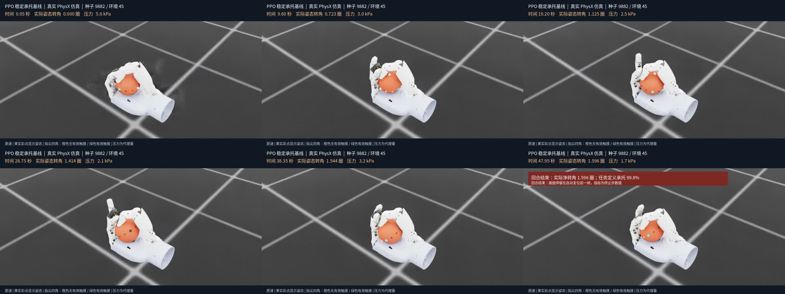
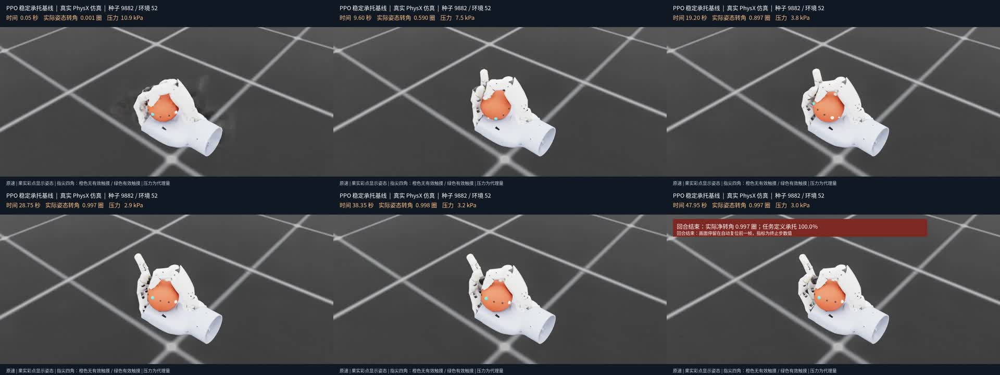
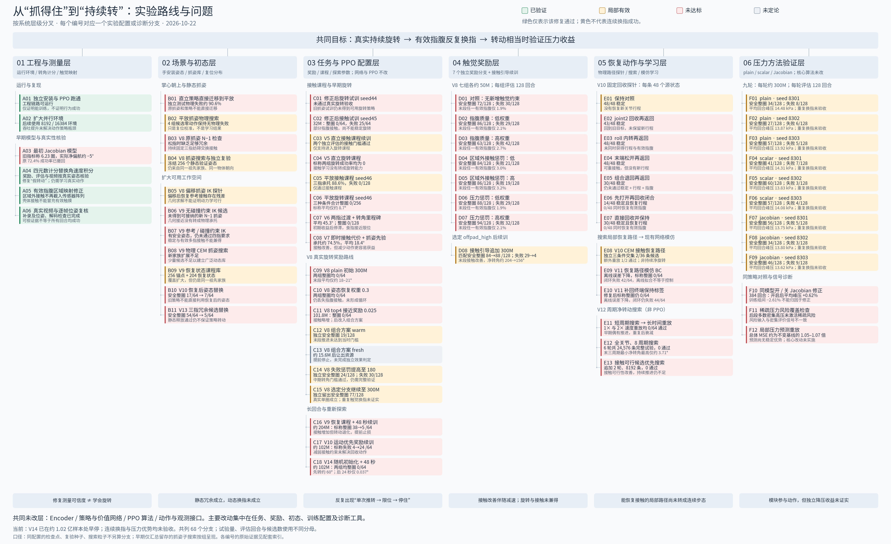

# 仿真与可视化索引

全部46个原始视频都在完整数据包，逐文件路径及哈希见 `ALL_VIDEOS.json`。以下8个另作为Release独立附件，便于不下载9GB包也能查看。它们属于不同实验，不能把不同种子/初态的视频当成配对因果证据。

|视频|说明|数据包中的原始路径|
|---|---|---|
|[v17_source_median](https://github.com/hwzhanng/linkagent/releases/download/roto2-handoff-20261026-all/v17_source_median.mp4)|成熟基线，中位回合；真实转动但仍减速|`artifacts/simulation/rotation_v17/ppo_pair/videos/source_median_all_episodes_env45.mp4`|
|[v17_validity_median](https://github.com/hwzhanng/linkagent/releases/download/roto2-handoff-20261026-all/v17_validity_median.mp4)|V17失败实验，中位回合；约29秒后停转|`artifacts/simulation/rotation_v17/ppo_pair/videos/validity_median_all_episodes_env52.mp4`|
|[v17_validity_best](https://github.com/hwzhanng/linkagent/releases/download/roto2-handoff-20261026-all/v17_validity_best.mp4)|V17最佳安全回合；不能代替总体结果|`artifacts/simulation/rotation_v17/ppo_pair/videos/validity_best_safe_env20.mp4`|
|[v10_recovery_cycles](https://github.com/hwzhanng/linkagent/releases/download/roto2-handoff-20261026-all/v10_recovery_cycles.mp4)|回收诊断；回收动作不等于连续净转动|`artifacts/simulation/rotation_v10/recovery_path_search/recovery_three_cycles.mp4`|
|[stage3_plain_median](https://github.com/hwzhanng/linkagent/releases/download/roto2-handoff-20261026-all/stage3_plain_median.mp4)|Stage3 plain种子8301中位回合|`artifacts/simulation/rotation_v8/stage3/results/plain_seed8301/videos_seed9101/median_seed9101_env37.mp4`|
|[stage3_scalar_median](https://github.com/hwzhanng/linkagent/releases/download/roto2-handoff-20261026-all/stage3_scalar_median.mp4)|Stage3 scalar种子8301中位回合|`artifacts/simulation/rotation_v8/stage3/results/scalar_seed8301/videos_seed9101/median_seed9101_env12.mp4`|
|[stage3_jacobian_median](https://github.com/hwzhanng/linkagent/releases/download/roto2-handoff-20261026-all/stage3_jacobian_median.mp4)|Stage3 Jacobian种子8301中位回合|`artifacts/simulation/rotation_v8/stage3/results/jacobian_seed8301/videos_seed9101/median_seed9101_env17.mp4`|
|[v8_static_thumb_release](https://github.com/hwzhanng/linkagent/releases/download/roto2-handoff-20261026-all/v8_static_thumb_release.mp4)|静态N-1释放；不等于动态换指成功|`artifacts/simulation/rotation_v8/stage0/anchor_thumb_release.mp4`|

## V17抽帧对照

这些是各自中位表现，不是同一个初态的成对样本。原始视频有实时转角与指腹状态叠加。

成熟基线：

V17实验：

## 历史路线图

完整横版路线图（68个历史分支）在数据包 `artifacts/simulation/roadmap_20261022/`，新版文字分支索引见 [EXPERIMENTS.md](EXPERIMENTS.md)。图的截止时间是2026-10-22，不能把它当作V17/V18最终状态。

[下载横版路线图PDF](images/roadmap_20261022.pdf)

