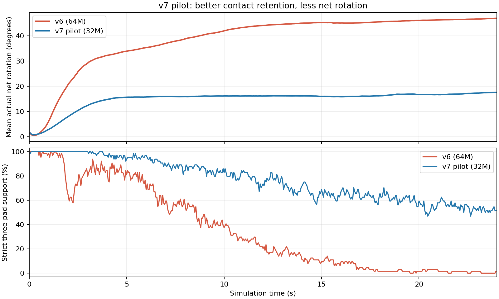

# LinkAgent L20 手内果实旋转：实验审阅包

> **最新补充：[阶段1首轮约3亿样本完成，持续旋转验收0/128](v8-stage1-300m/README.md)。** 最终两组10秒后平均净转角20.87°/18.26°，阶段1未通过；下一轮仅加强抓姿恢复代价。[阶段0](v8-stage0-passed/README.md)已冻结256个可松指初态。本页保留v1–v7训练历史，[v8早期失败实验](v8/README.md)另行保留，旧训练、权重及原始证据不覆盖。

**历史材料日期：2026-10-20｜分支：`research/roto2-object-pressure-track`｜本页描述v1–v7交付时状态；后续训练状态见上方最新补充。**

这份材料供老师在不依赖聊天记录、不访问原工作站的情况下审阅：研究目的、实现边界、所有保存的训练与评估记录、指标撤回原因、失败行为、论文依据、后续假设及复现入口。

> **最重要的结论：尚未证明模型能够持续完成真实一圈旋转，也未证明压力梯度修正优于基线或能减少真实水果损伤。早期“72.4%成功率”来自失真的角速度积分指标，已经撤回，不能引用为成果。最新v7的独立完整一圈成功为0/128。**

## 阅读顺序

1. 本页：研究背景、完整实验路线、当前结果和判断。
2. [方法、奖励、训练与评估口径](METHOD_AND_PROTOCOL.md)：输入/输出、PPO超参数、物理配置、指标定义和限制。
3. [所有运行和训练量](TRAINING_RUNS.md)、[所有评估](EVALUATIONS.md)：每项直接链接原始JSON，不只给汇总数字。
4. [当前思路与下一步实验](NEXT_EXPERIMENTS.md)：已验证事实、推断及未实施方案分开。
5. [复现、下载和完整性验证](REPRODUCE.md)：恢复全部证据、模型检查点、TensorBoard查看方式。
6. [文件清单](manifest.csv)、[库存统计](inventory_summary.json)、[归档校验](release_assets.json)、[交付前验证](HANDOFF_VALIDATION.json)、[GitHub上传校验回执](DELIVERY.json)。
7. [相对原远端提交cd97e7a的代码补丁](code_changes_from_cd97e7a.patch)：包含此前物理/任务适配修复及后来奖励迭代，不只本次文档修改。

## 一、研究问题和实现边界

固定腕部的单只右手LinkerHand L20，通过本体感觉、指腹触觉和果实表面稀疏压力信号学习转动果实；希望在保持有效接触、不掉落的条件下连续转动，并进一步比较稀疏压力梯度修正的价值。

底座采用作者发布的RoTO 2.0 `multimodal_rl` Encoder、策略/价值网络、PPO、GAE与优化器。任务环境、触觉几何、奖励和初始化适配L20，不能把它等同于原论文的Allegro/Shadow双球Baoding实验。没有训练真实机器人。

当前研究设计的附加机制是局部动作—压力Jacobian估计及小幅动作修正；但有效旋转尚未学成，最近评估中修正接受比例接近零，因而其减压优势没有被检验出来。不能把“代码接通”“压力数值较低”“回报上升”当作研究假设已成立。

当前Actor每帧502维（70本体/衍生量+432触觉/稀疏压力量），堆叠4帧；16个动作。没有新增教师、视觉编码器、循环网络或模仿学习模块。训练奖励与评估可以用仿真真实姿态，Actor不直接输入该姿态。

## 二、保存了什么，没保存什么

| 已盘点内容 | 数量 |
|---|---:|
| 运行目录，含训练、评估、探针等 | 78 |
| 有明确完成记录的训练 | 22 |
| 保存中途进度但没有完成标记的运行 | 1 |
| 上述22次运行新增转移数之和 | 743,631,248 |
| 另外一项中途运行的已保存转移数 | 1,034,880 |
| 评估JSON文档，含历史无效指标 | 40 |
| 有逐回合明细的记录行 | 2,048 |
| 导出的TensorBoard标量行 | 2,310 |
| 模型检查点文件 | 81 |
| 全部选取的原始证据文件 | 2,136 |
| 直接保存在本分支的原始证据文件 | 2,016 |
| Release中检查点及派生物理资产文件 | 120 |

**这些转移不是一份静态训练数据集。** PPO从并行PhysX环境在线采样，rollout用于更新后会复用内存；历史完整的逐步观测、动作、奖励、终止标记没有全部持久化。保存的是检查点、源代码快照、配置、完成/进度记录、TensorBoard事件、标准输出、独立评估和部分逐步诊断轨迹。不能据此提供一个不存在的7.44亿行离线经验集。

743,631,248包含初始化验证、吞吐基准、后来撤回指标的实验及不同分支尝试，并非全部“有效旋转训练数据”；也不包含未完成运行的未落盘尾部。`cumulative_training_transitions`表示某一权重继承链，**不能跨分支相加**。详细分母与缺失项均保留在运行表中。

原始证据按原相对路径镜像在`evidence/`，内容不改写；其中旧绝对路径和旧结论可能仍然存在，均是历史记录。本页及方法文档负责解释当前有效性。安装wheel/uv缓存约43GB、已安装运行时、无关tomato-pick任务和Python字节码未上传；安装日志、依赖清单、固定源码提交和恢复说明已保留。选择范围见[excluded.json](excluded.json)。

## 三、实验路线与模型继承

| 阶段 | 关键训练 | 主要发现与结论 |
|---|---|---|
| 链路/物理修复 | seed42，短程测试及256环境验证 | 修复接触报告匹配、内部碰撞、质量惯量、mimic限位、复位隔离等问题；训练链路可运行。详见历史验收记录，不能将这些修复与后来单纯奖励修改混淆 |
| 资源扩容 | 512→1,024→2,048→4,096→8,192→16,384环境 | 吞吐从约3.6k/s提升到约75.8k/s；不同环境数含不同样本量，属于资源基准，不是同预算学习效率对照 |
| 初次大训练 | seed42，最终一段94,279,680，继承链100,124,688 | 训练完成，但视频揭示“角速度积分圈数”与真实姿态不符；旧72.4%成功率撤回 |
| v2–v4修正探索 | seed43：32M→64M→32M | 改真实姿态计分、有效触觉区域和接触课程；保留全部结果与源码快照，不作为已达标方案 |
| v5新初态与接触课程 | seed44 32M旋转；seed45 32M+96M接触，再128M旋转 | 直立接触保持学成，连续旋转未成功；seed44与seed45不是同条件多随机种子复现 |
| v5掌心朝上 | seed46，64M接触+64M旋转 | 接触阶段严格承托88.6%；旋转后标称承托43.6%，平均净转角8.7°，完整任务0/256（含标称/轻扰动/全随机化） |
| v6两指过渡与里程碑 | seed47，64M正向regrasp | 转角增加，但变成初期推转后两指停住；小角度课程15/128通过，完整任务0/128。后续96M spin **未启动** |
| v7连续奖励与抓姿先验 | seed48，32M | 有效承托改善但更保守；平均18.4°，10秒后仅2.1°，完整任务0/128。额外检查最佳权重仍未成功 |

M在此是便于阅读的预算简称，实际执行数见运行表；例如32M实际为31,999,440，64M为63,998,880。

主要继承关系：

```text
seed45: 32M contact → +96M contact（稳定接触模型）
                         ├→ +128M vertical rotation
                         └→ seed46 +64M palm-up contact（累计191,996,640）
                                      ├→ seed46 +64M v5 rotation
                                      ├→ seed47 +64M v6 regrasp
                                      └→ seed48 +32M v7 continuous
```

v6与v7从同一个掌心朝上接触模型分叉，v7没有继续继承v6卡住的最终权重。配置中的`resumed_from`及对应检查点已全部保留；早期最小测试缺少某些配置字段时，运行表写为缺失，不事后补造。

## 四、指标撤回与修正过程

早期计数用报告角速度累计。固定seed2026/env0录像中，该计数声称约6.23圈，实际四元数轨迹的偏航范围仅约16.4°，首尾净偏航约-5°。因此旧“成功139/192（72.4%）”及旧平均圈数不能证明旋转，连带旧策略的旋转奖励学习也需重新审视。

现用真实果实四元数重构材料轴方向，逐步展开角度，离线用SciPy独立复算并检查一致性；加入姿态跳变和倾斜约束。不能单凭当前计数修复就宣布旧权重成功。

另一个问题是原触觉映射会把区域外接触钳入有效taxel。现在使用拟合的指腹有效矩形、前表面深度及真实接触力判断，区域外接触不会被伪装成有效触摸。但这是厂商网格导出的工程先验，尚未做真实传感器标定。

掌心朝上初试还暴露了Isaac Lab 3的XYZW四元数顺序问题；错误姿态的探针文件以`rejected_wrong_quat`标识并保留，不能混入正确平放训练结论。

审阅入口：

- [旧指标录像核验](evidence/artifacts/simulation/video_verification.json)
- [初次大训练原始记录（含撤回指标，勿引用为有效结果）](evidence/logs/roto2_pressure_fruit/jacobian_seed42/2026-10-19_23-03-40/)
- [掌心朝上错误/正确初始化诊断](evidence/simulation/.runtime/setup/palm_up/)
- [当前姿态与有效触觉实现](../../../simulation/roto2_pressure/reward_geometry.py)

## 五、当前主要结果

以下是描述性结果，不是预算、方向和训练种子均匹配的因果消融。

| 检查点/测试 | 评估回合 | 严格三指承托 | 平均实际净转角 | 完整一圈成功 |
|---|---:|---:|---:|---:|
| v5直立，最终旋转，标称双向 | 128 | 87.46% | 8.71° | 0/128 |
| v5平放，最终旋转，标称双向 | 128 | 43.57% | 8.67° | 0/128 |
| v6平放，最终regrasp，标称正向 | 128 | 34.34% | 45.34° | 0/128 |
| v7平放，最终continuous，标称正向 | 128 | 74.48% | 18.43° | 0/128 |
| v7最佳训练内回报权重，标称正向 | 64 | 87.39% | 11.36° | 0/64 |

v6排除首秒后121/128回合达到30°，但满足承托等完整课程条件的只有15/128。v7最终模型物理失败1/128；10秒之后平均仅再转2.14°，最佳权重该指标为-0.55°。即使物体不掉、有效接触增加，也不能称为持续旋转。

最近压力Jacobian修正接受率几乎为零：v7两种子均为0；v6一组约0.0065%、另一组0。当前无法声称核心压力修正机制改善了任务，更没有plain/scalar/jacobian同预算、多训练种子的有效旋转对照。



## 六、失败机理：事实、解释与边界

**实际观察。** v6先转动约45°，10–15秒后停止；后期食指有效接触约11.5%，joint0约85.9%的时间接近上限。v7诊断中这两项改善为约72.6%和42.1%，但转角更小。不同诊断种子下的这些数值只支持描述性比较。

**奖励时序解释。** v6先领取小角度里程碑，再长期保持两指。gamma=0.99、20Hz下，10秒/20秒后的奖励权重约0.134/0.018。诊断回放中，最终策略折扣回报更高、整段未折扣回报更差，支持早期收益与后期恢复代价不匹配的解释；并不证明gamma是唯一原因。

**v7的具体限制。** 删除一次性里程碑、即时惩罚缺少三指及区域外接触、加入弱抓姿代价后，策略减少了接触退化，也减少了推进。统一按原始弧度平方计费的抓姿代价，约78.6%落在无名指/小指，食指关键joint0仅6.6%；不同关节行程没有归一化。无名指仍长期靠有效区域外接触承托。当前方法没有提供足够针对性的可重复恢复路径。

**尚不成立的推断。** 不能据此认定L20机械上不能旋转、核心网络容量不足、所有抓姿先验无效或增加样本必然无用。只测试了有限配置和单个训练种子，且v7仅61次PPO更新。大并行提高吞吐，但不自动提高每百万样本的更新频率或长时动作探索能力。

## 七、论文依据与本项目适配

- [Hora，CoRL 2022](https://proceedings.mlr.press/v205/qi23a/qi23a.pdf)：连续转动配合抓姿/运动代价，启发v7的最小连续奖励。其手型、适应模块和控制设置不同，本项目没有直接复现该论文系统。
- [AnyRotate，ViTac 2024](https://shanluo.github.io/ViTacWorkshops/content/ViTac2024_Paper_13.pdf)：区分有效指尖和外壳接触，启发直接惩罚区域外受力。本项目没有引入目标姿态教师或蒸馏。
- [Tac2Motion，2025](https://arxiv.org/html/2509.17812v1)：提供接触与推进结合的参考，但瓶盖导向结构和额外虚拟扭矩不适用于当前自由持果任务，未照搬。
- [RoTO 2.0](https://arxiv.org/html/2605.21429v1)：沿用其上游PPO；Baoding任务和覆盖多个连杆的触觉设置不等于本项目的单物体自身旋转。

完整分析见[v7设计](reports/v7_design.md)、[v7结果](reports/v7_review.md)、[v6设计](reports/v6_design.md)、[v6结果](reports/v6_review.md)。

## 八、下一步最小可检验假设

优先在真实卡住姿态做有对照的回退/重抓物理探针，检验是否存在低角度损失的恢复动作。再考虑按可用关节行程归一化、仅针对失去有效接触手指的恢复代价，或少量恢复状态课程。先验证重复推进，再扩大双向和随机化；网络、PPO实现和动作架构保持不变。

这些方案**尚未实施或证明有效**。具体成功/停止标准、潜在反例及比较设计见[NEXT_EXPERIMENTS.md](NEXT_EXPERIMENTS.md)。

## 九、数据入口与审阅便利

- [训练CSV](tables/runs.csv) / [JSON](tables/runs.json)
- [评估CSV](tables/evaluations.csv) / [JSON](tables/evaluations.json)
- [逐回合CSV](tables/episodes.csv) / [JSON](tables/episodes.json)
- [TensorBoard标量CSV](tables/tensorboard_scalars.csv)，原始事件在各运行目录中
- [v7真实仿真录像](evidence/artifacts/simulation/rotation_v7/trial_seed48/nominal_seed2071_video.mp4)
- [v6真实仿真录像](evidence/artifacts/simulation/rotation_v6/trial_seed47/regrasp_seed2061.mp4)
- [全部原始实验输出](evidence/artifacts/simulation/)，[原始运行日志与快照](evidence/logs/roto2_pressure_fruit/)
- [安装、物理探针、缩放基准与诊断](evidence/simulation/.runtime/setup/)
- [检查点及物理资产Release](https://github.com/hwzhanng/linkagent/releases/tag/roto2-review-20261020-v7)

视频是实际PhysX渲染，不是生成式示意图；彩色果实标记仅为视觉展示，不输入策略，也不改变接触动力学。压力单位标注来自仿真代理，不是已标定的真实组织应力。私有仓库权限与附件访问权限沿用当前仓库设置。
