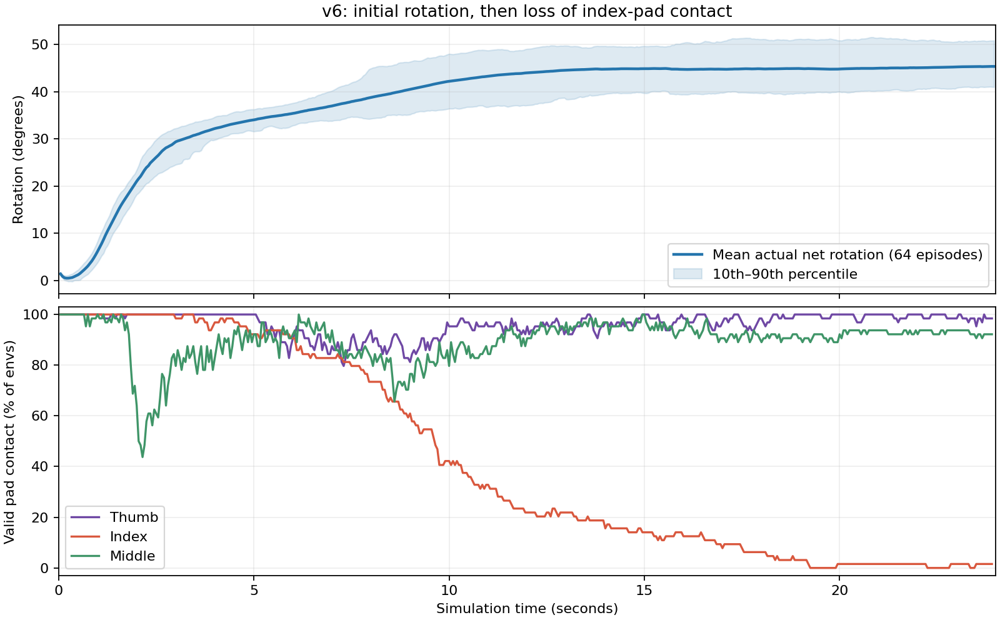

> 阅读副本：仅将本机链接改为仓库链接；原始文档见[逐字证据副本](../evidence/artifacts/simulation/rotation_v6/trial_seed47/REVIEW.md)。模型链接统一指向恢复说明。

# v6训练后诊断（2026-10-20）

结论：掌心朝上后，策略学会了初期真实推转，但没有学会循环换指和持续旋转。第一阶段课程未通过；并非PPO进程崩溃。当前没有继续训练，第二阶段96M没有执行。

## 完成状态与结果

16,384环境完成63,998,880条新训练转移、122次PPO更新；训练结果记录806.05秒。全部训练模块参数有限且发生更新。检查点保留在`logs/roto2_pressure_fruit/jacobian_seed47/2026-10-20_10-11-56/checkpoints/final_agent.pt`。

独立标称正向评估seed2061/2062，各64回合：

| 指标 | 结果 |
|---|---:|
| 完整一圈任务成功 | 0/128 |
| 排除前1秒沉降后净转角达到30° | 121/128 |
| 同时达到30°及承托等课程条件 | 15/128（11.7%） |
| 严格三指有效传感区域承托率 | 34.3% |
| 平均实际净转角 | 45.34° |
| 排除前1秒后的平均实际净转角 | 39.14° |
| 物理失败 | 0/128 |

无掉落不能代替旋转成功。这些是标称正向任务的结果，没有双向或完整随机化成功证据。

## 录像与轨迹揭示的问题

实际PhysX录像的第100、478帧已人工查看。seed2061的64环境均值在1/3/5/10/15/20/23.95秒约为6.2/29.4/34.0/42.2/44.9/44.8/45.3度：初期推进，随后停滞。录像env0后期主要是拇指与中指夹持，食指没有有效恢复。

对最终权重另做64环境完整回合只读诊断，记录关节位置、目标、策略动作、原始接触力、有效传感区域及奖励。10–24秒非终止样本：

- 食指有效区域接触占11.5%；接触力不超过0.15N占45.4%；接触力足够但落在有效区域之外占43.1%。它既存在脱离/弱接触，也存在滑出传感区域的问题。
- `index_joint0`范围[-0.26,0.26]rad；85.9%的样本处于距上限0.02rad以内。60.1%的样本同时处于该上限附近且策略输出仍指向上限方向。这里记录的是策略原始动作，不能等同于压力修正后的执行动作。
- 原接触权重的同配置诊断中，该关节后半段仅10.8%的样本接近上限，食指有效接触85.4%。因此不是初始姿态必然将食指锁在限位；新策略明显加剧了该行为。

这是“单次推转—食指到限位并丢失有效接触—两指停住”的证据；不能据此认定硬件或核心网络不具备换指能力。

## 奖励设计的缺口

v6允许两指产生旋转信用，以便探索换指，但仅通过三指占空比软罚和一次性里程碑鼓励恢复。它没有限定两指过渡持续时间，也不要求完成一次恢复后才能继续领取后续推进奖励。早期5/10/20度里程碑可在首次推转时领取，不能证明学会了“脱离后重新接触”。

当前控制周期0.05秒、gamma=0.99：10秒后的奖励权重约0.134，20秒后约0.018。新诊断回放结果：

| 每回合均值 | 原接触模型 | v6最终模型 |
|---|---:|---:|
| 整段未折扣总回报 | -17.240 | -21.825 |
| gamma=0.99折扣回报 | -0.145 | +5.857 |

最终模型折扣后的旋转与里程碑奖励合计约10.93，而折扣后的承托缺失罚项仅约-1.11。这支持“早期收益压过后期恢复代价”的解释；不是只凭gamma数值断言唯一原因。GAE/价值估计仍有自举，不能把其衰减时间直接理解成模型完全看不到未来。

这次新回放与历史训练前基线不是逐状态配对实验：历史基线启用了validate-contracts，会消耗复位/RNG状态。历史基线90.3%承托率仍保留；此次回放用于同时记录两套权重的动作和奖励时序，不替代原始评估。

训练中保存的未折扣评估回报也没有持续改善（7.84M时约-10.70，62.72M时约-21.51）。单纯延长现有奖励下的训练缺乏依据。

## 下一轮应针对的修改

尚未在本次诊断中实施新的奖励或长训练：

1. 将推进与恢复组成重复的小角度课程；里程碑必须验证丢失接触后真实重新建立接触，而非只看当时三指是否存在。
2. 为两指过渡设置有限恢复窗口；恢复失败应及时反映到奖励/课程结束，避免代价全部落在回合后半段。
3. 用短实验验证食指回退、重新接触与再次推进是否出现；从稳定接触权重开始，不直接延续已陷入限位的最终权重。
4. 检查课程时间尺度与折扣/采样跨度是否匹配，再决定训练超参数；保留PPO/GAE实现和网络架构。
5. 依据多次推进、恢复次数、三指承托、净转角共同评估检查点，不能仅凭总回报或最后一份权重。

仍保持原始完整一圈验收标准。新方案能否改善需要新的物理回放验证，目前不宣称已修复。

## 修改边界与证据

本次只新增只读策略轨迹诊断入口、分析图和报告，没有修改奖励或重新启动训练。agent.yaml、core.py、asset.py、pressure_track.py与v6修改前快照逐字节一致，训练构建函数AST一致，上游multimodal_rl工作树干净。网络、PPO/GAE/优化器、观测/动作维度未改。

- [结果汇总](../evidence/artifacts/simulation/rotation_v6/trial_seed47/review_summary.json)
- [逐时段诊断数据](../evidence/simulation/.runtime/setup/rotation_v6/review/trace_comparison.json)
- [架构复核](../evidence/simulation/.runtime/setup/rotation_v6/review/architecture_check.json)
- [真实仿真录像](../evidence/artifacts/simulation/rotation_v6/trial_seed47/regrasp_seed2061.mp4)

