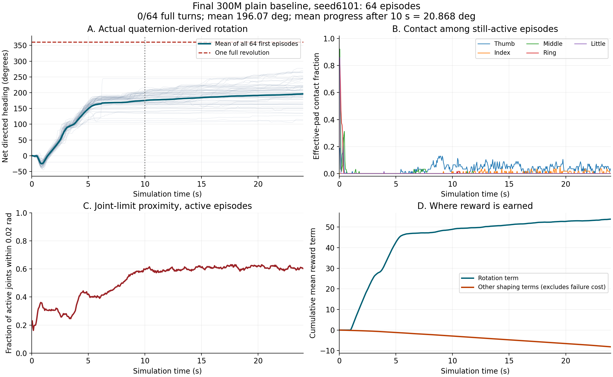

# v8 阶段 1：首轮约 3 亿样本完成，持续旋转验收未通过

**结论：训练正常完成，但目标未完成。** 新的任意三指或稳定承托定义、256 个可松指抓姿、从头初始化的 plain PPO，已经使前段真实转角明显增加；最终独立测试仍为 **0/128 完整安全一圈**。10 秒之后平均净转角分别为 **20.87°、18.26°**，没有达到每组 >90° 的阶段 1 门槛。不能把训练回报上涨、前段半圈推转或稳定承托比例高解释成持续换指成功。

这是一个训练种子 seed49 的实验，包含一次中断和精确检查点续训。两个最终评估种子是测试初态随机化，不是两个独立训练种子。阶段 2 触觉约束和阶段 3 三方法 × 至少三训练种子的比较仍未开始。

## 1. 最终结果与分母

每组 64 个环境各取第一个完整回合，最长 24 秒，20 Hz 控制。物理失败回合保留在分母内；首次终止后不累计新回合。转角来自真实物体四元数轨迹的材料轴朝向增量，经独立 SciPy 实现复算，不使用角速度积分替代。

| 测试种子 | 用途 | 完整安全一圈 | 平均总净转角 | 10 秒后平均净转角 | 最大总净转角 | 最大后段净转角 | 物理失败 |
|---|---|---:|---:|---:|---:|---:|---:|
| 6101 | 最终独立验收 | 0/64 | 196.07° | 20.87° | 277.31° | 70.22° | 7/64 |
| 6102 | 最终独立验收 | 0/64 | 188.20° | 18.26° | 267.50° | 70.21° | 11/64 |
| 5101 | 与中途检查点匹配诊断 | 0/64 | 181.63° | 14.66° | 263.38° | 59.98° | 4/64 |

最终正式验收分母是前两行的 128 回合；匹配诊断额外 64 回合，不混入正式验收分母。三组总计 192 个最终检查点评估回合，均没有完整一圈。阶段 1 门槛要求每个独立种子同时满足：10 秒后平均净推进 >90°、至少一次完整安全一圈，并复核实际录像。完整一圈还检查任务承托、姿态、压力、物理失败和异常姿态跳变；没有为本轮修改门槛。

原始结果及逐回合数据：

- [最终量化门槛](evidence/artifacts/simulation/rotation_v8/stage1/final_validation/QUANTITATIVE_GATE.json)
- [seed6101](evidence/artifacts/simulation/rotation_v8/stage1/final_validation/final_seed6101.json)、[seed6102](evidence/artifacts/simulation/rotation_v8/stage1/final_validation/final_seed6102.json)、[匹配 seed5101](evidence/artifacts/simulation/rotation_v8/stage1/final_validation/final_seed5101.json)
- 对应 `.npz` 原始姿态、初始姿态、有效回合掩码、指腹接触及目标速度在 Release，字段形状见 [npz_schema.json](npz_schema.json)。

## 2. 录像与实际动作

[代表性回合 env14](evidence/artifacts/simulation/rotation_v8/stage1/final_validation/final_seed6101_median_env14.mp4)按 seed6101 的后段净转角中位数选取；[后段表现最好回合 env11](evidence/artifacts/simulation/rotation_v8/stage1/final_validation/final_seed6101_best_env11.mp4)按同一组最大后段净转角选取。没有挑选成功回合，因为不存在成功回合。

两段均为真实速度播放，记录 479 个物理控制步；片尾另有标明结束的静帧。球面六方向彩色标记和不对称点环仅作显示，没有碰撞体，不产生额外接触。逐帧物体姿态与独立评估对应环境完全一致，最大差为 0；视频全量解码通过。实际检查了两段的第 0、100、200、470 帧，具体边界见 [VISUAL_REVIEW.json](evidence/artifacts/simulation/rotation_v8/stage1/final_validation/VISUAL_REVIEW.json)。



可见前段球面标记确实发生转动，随后手指进入明显张开、近限位姿态，后段标记移动减慢。最佳回合仍有慢速推进，但没有完整一圈，也没有足够证据证明形成可重复换指循环。中位回合最终约 0.5963 圈，最佳后段回合最终约 0.7493 圈；后者不一定是总转角最大的回合。

图中 A、D 的分母是全部 64 个首次回合，终止后冻结累计量；B、C 是每一时刻仍有效的回合/关节，CSV 保留有效回合数。D 不包含单独施加的物理失败代价，因此不能直接当整回合总回报。

## 3. 精确训练量、恢复过程和计算环境

训练累计 **299,993,792 条环境转移、2293 次 PPO 更新**。名义预算 300,000,000 与实际相差 6,208，来自批量环境步数的整数取整；没有把不足部分补写成已训练数据。

| 段 | 运行目录 | 保存并计入的样本 | PPO 更新 | 状态 |
|---|---|---:|---:|---|
| 从头训练 | `logs/roto2_pressure_fruit/plain_seed49/2026-10-20_20-53-18` | 117,497,296 | 898 | SIGTERM 中断，无完成标记 |
| 检查点续训 | `logs/roto2_pressure_fruit/plain_seed49/2026-10-20_21-34-12` | 182,496,496 | 1395 | 正常完成，参数有限 |
| 合计 | 同一训练谱系 | 299,993,792 | 2293 | 首轮预算完成，任务验收失败 |

原始进程退出码 143，发送方和原因没有确定。没有证据把它归因为 OOM 或特定工具超时。只恢复最后完整检查点；中断前未保存的尾部交互不计入上述累计训练量。

续训初始检查点与原检查点的 encoder、policy、value、全部三个优化器、状态和价值预处理器逐张量/状态一致，探索标准差也保留。**仿真环境状态和随机数状态不在检查点内，因此不是逐比特等同于未中断训练。** 旧版本未写累计更新数，898 次更新由一致的 Adam 步数及每次更新 8 epochs × 4 minibatches 核对；随后增加了明确的累计计数日志，没有修改 PPO 更新逻辑。

恢复证据：[RESUME_VALIDATION.json](evidence/artifacts/simulation/rotation_v8/stage1/RESUME_VALIDATION.json)、[ACCOUNTING_VALIDATION.json](evidence/artifacts/simulation/rotation_v8/stage1/ACCOUNTING_VALIDATION.json)、[中断记录](evidence/artifacts/simulation/rotation_v8/stage1/interruption_117M/INTERRUPTION.json)。完整段信息见 [training_segments.json](training_segments.json)。

实际设备 NVIDIA RTX 5090，显存 32607 MiB；运行期间另有其他 GPU 作业，不能把整卡利用率都归因于本训练。软件版本、驱动与上游提交见 [RUNTIME_ENVIRONMENT.json](evidence/artifacts/simulation/rotation_v8/stage1/RUNTIME_ENVIRONMENT.json)。运行目录名是安装时命名，实际安装分发版本单独记录。

最终权重 SHA-256：

`5d8d79241ffb6cd24f50f2993420ee0fe2b78d9de7640186ade4ee5ac070fe38`

## 4. 配方、初态和奖励的完整边界

- 8192 总环境：8176 训练、16 在线评估；rollout 16；8 epochs、4 minibatches；学习率 0.000202、γ=0.99、GAE λ=0.95、clip=0.2、梯度裁剪 1。网络、上游 PPO、观测和动作映射不变。
- 从头初始化，seed49，初始动作标准差 0.6、熵系数 0.005；plain，压力修正关闭。
- 掌心朝上，标称直径 64 mm 球，正向目标速度 0.3–0.5 rad/s；物理 120 Hz、控制 20 Hz，单回合 24 秒。
- 每次复位均匀采样冻结 256 抓姿。库 SHA-256 为 `d667c5bb3d8442133460886ce35e086b53bfe73d89c8dabb08f3b015890243c8`。这些是一个祖先抓握类型的局部变化，食指通常不承担初态有效指腹接触；不能宣称跨抓握类型或跨果实形状泛化。
- 任务承托：任意 ≥3 指有效指腹，或物体稳定（球心位移 <25 mm、速度 <0.12 m/s、高度下降 <15 mm、倾斜余弦 >0.5）。稳定承托可以来自掌心/其他部位，因此任务承托率约 83% 不意味着指腹接触良好。
- 真实姿态差分角速度为主奖励，正向截断到目标速度 2 倍，反向不截断以避免快速回退刷分；首秒不计正向运动信用。姿态路径异常或压力超限使路径信用失效。
- 姿态代价 `−0.01 × mean(((q−q_ref)/joint_range)^2)`；做功 `−0.002 × sum(abs(torque*qdot))`；有效指腹小额加分 `+0.005 × mean(contact)`。
- 线速度 `−0.05×speed`；中心 `−0.02×clip((displacement/0.05)^2,max=9)`；倾斜 `−0.05×tilt²`；动作差 `−0.001×mean(delta_action²)`；每步时间 `−0.005`；无效路径 `−0.2`；物理失败代价 −60。区域外接触惩罚关闭。

精确公式以各运行目录的源码快照为准，所有配置均在 `run_config.json` 中。核心函数 AST 一致性证据：[CORE_ARCHITECTURE_VERIFICATION.json](evidence/artifacts/simulation/rotation_v8/stage1/CORE_ARCHITECTURE_VERIFICATION.json)。

## 5. 训练过程：更多前段转角，尚无循环

以下均使用匹配测试 seed5101、64 首次回合，避免把初态种子变化误当训练改善：

| 保存样本数 | 平均总净角 | 10 秒后平均净角 | 完整安全一圈 | 物理失败 |
|---:|---:|---:|---:|---:|
| 31,338,608 | 97.92° | −0.09° | 0/64 | 5/64 |
| 101,832,080 | 158.70° | 2.08° | 0/64 | 9/64 |
| 203,664,160 | 159.82° | 7.73° | 0/64 | 6/64 |
| 299,993,792 | 181.63° | 14.66° | 0/64 | 4/64 |

它们是同一训练种子的不同检查点，不能用作独立训练重复实验。中途 checkpoint、逐步 NPZ、日志和奖励分项全部保留。匹配数据支持“确有渐进改善”，也明确反对“已经学会持续旋转”的结论。

最终 seed6101 匹配动作轨迹和独立评估的非终止物体姿态完全一致。排除自动复位可能替换的终止步接触缓冲后：

- 1–5 秒每回合旋转项约 +42.16，但有效指腹数量仅约 0.0012（分母为该窗有效环境步）。
- 10 秒以后旋转项约 +4.96，约 60.5% 的有效关节位于距限位 0.02 rad 内；有效指腹数量约 0.0513。
- 57 个未失败回合的末端球心偏移中位数 22.25 mm，四分位范围 19.20–25.15 mm。
- 最终动作探索标准差均值约 0.0845，明显低于初始 0.6。记录这一变化，但没有单凭相关性断言探索下降就是根因。

详见 [FINAL_ACTION_DIAGNOSIS.json](evidence/artifacts/simulation/rotation_v8/stage1/final_validation/FINAL_ACTION_DIAGNOSIS.json)。另外的 CPU IK 探针仅追踪同一四指参考几何在偏移后的残差；没有碰撞和力学验证，不能证明不可达，更没有进入训练抓姿库。

## 6. 下一项最小修正及成功实现的参考边界

下一轮选择只将归一化抓姿偏离代价权重从 **0.01 提高到 0.3**，其余训练设置保持一致，从头训练同一 seed49，独立运行目录。目的是降低长期停在极限姿态的收益，给恢复可重复动作的姿态以稠密引导。保持任意三指或稳定承托，不重新要求拇指一直在线；不修改网络、PPO、动作动力学、有效传感区和验收门槛。

这个候选是待验证的任务奖励修正，不是已证实的解决方案。对原轨迹离线重评分可校准代价量级，但不能预测新策略一定学会换指。风险是过强姿态先验抑制运动，以及物体已偏移后原始关节姿态未必仍适合；若出现这些情况，应结合中心漂移/接触轨迹进一步判断，不能只继续盲目加大系数。

已核对 Hora 官方 [任务实现](https://github.com/HaozhiQi/hora/blob/410d95824dd28b198f6d6910cb4c09330a6303be/hora/tasks/allegro_hand_hora.py)、[任务配置](https://github.com/HaozhiQi/hora/blob/410d95824dd28b198f6d6910cb4c09330a6303be/configs/task/AllegroHandHora.yaml)及[训练配置](https://github.com/HaozhiQi/hora/blob/410d95824dd28b198f6d6910cb4c09330a6303be/configs/train/AllegroHandHora.yaml)。本项目只借鉴任务奖励和抓姿缓存的思路；机器人、关节量纲、网络与训练实现不同，不能把 0.3 的数值相同称作等价配方或完整 Hora 复现。

## 7. 复现入口与资料完整性

原始启动：

```bash
bash simulation/.runtime/run_roto2.sh train \
  --num-envs 8192 --seed 49 --million-steps 300 \
  --pressure-variant plain --domain-profile nominal \
  --hand-posture palm_up --reward-stage baseline --goal-direction positive \
  --rollout-steps 16 --initial-action-std 0.6 --entropy-weight 0.005 \
  --reset-grasps simulation/roto2_pressure/reset_grasps_v8_validated256.json \
  --validate-contracts
```

最终评估命令逐条保存在 [COMMANDS.json](evidence/artifacts/simulation/rotation_v8/stage1/final_validation/COMMANDS.json)。用最终 checkpoint、64 环境、相同标称任务参数，分别 seed6101、6102。用于诊断的 seed5101 和动作 trace 另有独立日志及配置。

新机器的依赖安装和物理资产恢复参见[基础环境复现说明](../REPRODUCE.md)第二节；其中旧 v7 训练/评估命令不适用于本轮。`simulation/.runtime/run_roto2.sh` 是本机便利包装器；已装好环境时，可将上述命令开头的 `bash simulation/.runtime/run_roto2.sh train` 替换为 `"$LINKAGENT_ISAACLAB_ROOT/env_isaaclab/bin/python" -m script.train_roto2_pressure --headless`，其余参数保留。先把 `LINKAGENT_ISAACLAB_ROOT` 指向实际安装目录。没有在另一台干净机器重新安装验证，不承诺跨驱动逐位复现。

[manifest.json](manifest.json)列出全部已保存证据的路径、字节数、SHA-256、分支镜像及归档成员；[checkpoints.json](checkpoints.json)列出权重/优化器的有限值检查；[tensorboard_scalars.csv](tensorboard_scalars.csv)导出全部已存 TensorBoard 标量；[source_manifest.json](source_manifest.json)列出交付源码哈希；[VALIDATION.json](VALIDATION.json)记录归档数量和核验结果。

**没有保存完整 3 亿行离线训练数据。** PPO 的 on-policy rollout 缓冲循环复用。本次“数据齐全”指完整交付已经保存的日志、配置、检查点、标量、独立评估原始轨迹、诊断与录像；不会声称没有保存的全量逐样本观测/动作仍然存在。失败试验和中断痕迹一并保留。

本包只冻结这一轮已完成的训练及诊断，下一轮修改不覆盖此包。此前 [阶段 0 报告](../v8-stage0-passed/README.md)及旧 Release 保持原样。

完整数据：[roto2-review-20261020-v8-stage1-300m Release](https://github.com/hwzhanng/linkagent/releases/tag/roto2-review-20261020-v8-stage1-300m)。GitHub 分支内可以直接读报告、JSON、日志、图和视频；模型、NPZ、原始 TensorBoard 文件在 Release 归档，按 manifest 对应提取。
