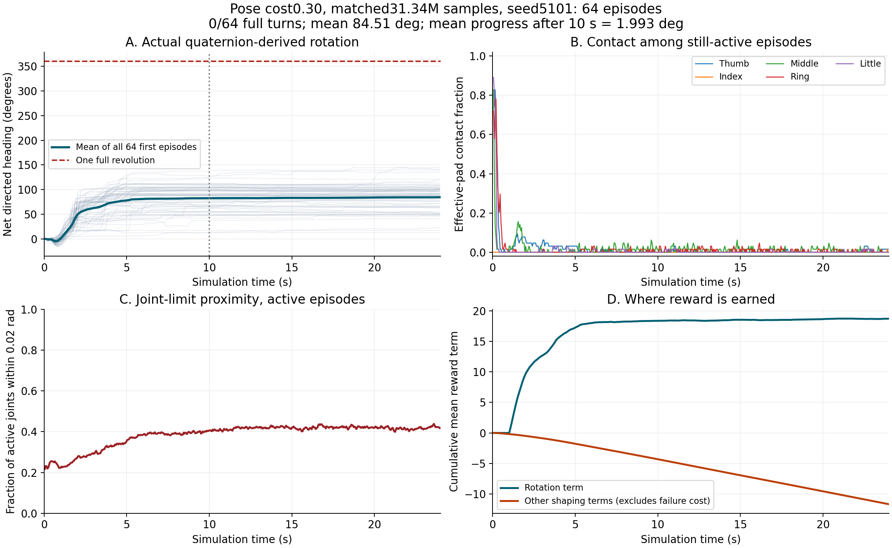
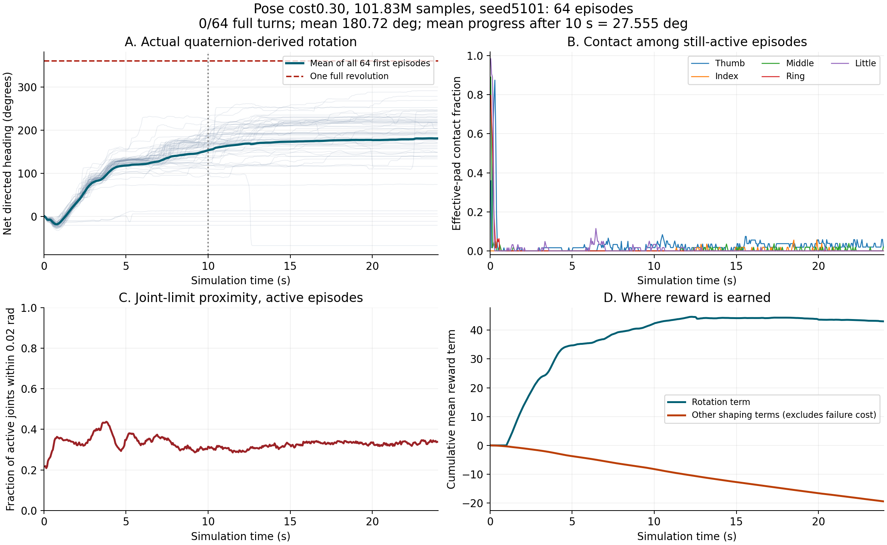

# 阶段1第二轮：单独增强抓姿恢复代价（运行中）

上一轮[约3亿样本基线](../v8-stage1-300m/README.md)完成，但独立完整一圈0/128，阶段1未通过。本轮不是阶段2，也不构成研究对比结果。

仅将归一化关节抓姿偏离代价权重从0.01提高到0.3。其余配方不变：plain、掌心朝上、标称64mm球、正向0.3–0.5rad/s、冻结256初态、8192总环境（8176训练/16在线评估）、rollout16、初始探索标准差0.6、熵系数0.005、从头训练seed49、300M预算。

网络、PPO构造、观测、动作映射、关节限位、物理失效逻辑与完整一圈验收门槛不变。128个随机任务状态的回归检查确认默认0.01与冻结旧实现逐位一致；0.3只改变姿态代价分项，承托和运动项一致。原有任务契约检查通过。

两个训练运行保存的全部初始网络、优化器、状态/价值预处理器逐项完全一致。这个证据控制初始化差异，但不承诺PhysX轨迹逐位可重复。具体见[INITIAL_STATE_COMPARISON.json](INITIAL_STATE_COMPARISON.json)、[CORE_VERIFICATION.json](CORE_VERIFICATION.json)、[REWARD_CONTRACT.json](REWARD_CONTRACT.json)。

本轮运行目录：`logs/roto2_pressure_fruit/plain_seed49/2026-10-20_22-40-21`。训练服务`roto2-stage1-pose030-seed49.service`；实际命令和源码提交见[TRAINING_SPEC.json](TRAINING_SPEC.json)。启动后的检查点已经产生59次PPO更新、7,840,784条环境转移，模型和优化器张量均有限，三个优化器步数均为1888（59×8×4）。这是已保存的启动验证快照，不是此页读取时的实时进度。

设有30M、100M、200M稳定检查点保存，并在完整预算结束后自动运行seed6101/6102各64回合和代表性/最佳后段录像。完整正式验收仍要求每组10秒后平均净转角>90°且出现安全完整一圈，并实际复核录像。阶段2/3等待该门槛通过。

本目录发布启动配置和阶段性验证证据。持续变化的训练日志、权重和最终轨迹在本机保留，结束或明确中止后另行冻结交付，不覆盖上一轮归档。尚无本轮成功结论。

## 31M早期匹配检查点，尚未通过

同样31,338,608样本、训练seed49、测试seed5101、64回合；初始模型/优化器/归一化状态以及测试物体初态一致。

| 配方 | 完整安全一圈 | 物理失败 | 平均总净角 | 后10秒平均净角 | 后段近限位关节比例 |
|---|---:|---:|---:|---:|---:|
| 旧姿态权重0.01 | 0/64 | 5/64 | 97.92° | −0.09° | 72.79% |
| 新姿态权重0.30 | 0/64 | 0/64 | 84.51° | 1.99° | 41.86% |

这个单训练种子的早期对照显示限位停留减少，但有效指腹接触没有恢复，也没有完整一圈。不能把无物理失败当成任务成功。新配方后段平均有效指腹数约0.022；指端接触事件中约88.7%落在当前有效区域之外，未修改区域定义。各指标的精确分母、终止步排除方式及原始来源见[匹配比较](EARLY_MATCHED_COMPARISON.json)与[接触位置诊断](CONTACT_LOCATION_DIAGNOSIS.json)。

[逐回合评估](early31M/evaluation_seed5101.json)、[检查点来源与哈希](early31M/PROVENANCE.json)、[论文与接触恢复候选](LITERATURE_AND_CONTACT_RECOVERY.md)。此处发布早期汇总、逐回合JSON、图表和命令；对应NPZ、日志和模型仍保留本机，待本轮结束后完整冻结交付。当前正在运行的奖励没有加入接近项。

## 101.83M匹配检查点：后段转动改善，稳定性下降，仍未通过

两轮均为101,832,080样本、训练seed49、评估seed5101、64回合；已逐元素核对评估初始物体位姿、目标速度和方向完全一致。对照是同一训练种子的中间检查点，不是多种子结论。

| 配方 | 完整安全一圈 | 物理失败 | 平均总净角 | 后10秒平均净角 |
|---|---:|---:|---:|---:|
| 旧姿态权重0.01 | 0/64 | 9/64 | 158.70° | 2.08° |
| 新姿态权重0.30 | 0/64 | 13/64 | 180.72° | 27.56° |

本轮最大总净转角291.36°，没有任何原始完整一圈；个别回合后10秒净转角最大132.62°，但全体平均27.56°仍低于90°门槛。不能把这个最大值当作阶段1通过。独立评估与动作诊断的非终止步物体轨迹完全匹配。

实际查看图后，仍表现为前段推进、后段趋于平台，有效指腹接触几乎消失。后10秒15,193个仍活动且非终止的环境时间步中，近限位关节占32.30%，平均有效指腹数0.03594。按五指分别平均，指腹中心到球面间隙约14–32mm；这些几何量不等于接触，也不能证明某个换指动作可行。指腹标记从原始接触位置、力和未修改的传感区域重新计算，逐项一致。

另一个实质问题是承托和运动奖励的关系：后段有5,415步满足运动奖励的路径及承托条件，8,668步路径有效但缺乏承托，1,110步路径无效。全部9,444个缺乏承托的后段时间步中，9,061步的果实中心偏移达到25mm，已不满足当前稳定承托的位移条件；有效指腹接触又不足。后段中心偏移中位数26.60mm。多个条件可以同时失败，此计数不能归因成“仅位移导致”。

依据真实位姿和承托记录重新计算后段运动奖励，与保存值的最大差异小于0.00001。这说明27.56°原始后段转角并不全部属于可获奖励的稳定运动；不能只看总转角推断接触已经改善。下一步重点检验接触恢复和位置保持，尚未添加接近项、放宽稳定阈值或改变正在运行的配方。

详细证据：[逐回合评估](milestone100M/evaluation_seed5101.json)、[匹配对照](milestone100M/MATCHED_COMPARISON.json)、[接触恢复和奖励分解](milestone100M/RECONTACT_DIAGNOSIS.json)、[命令及退出状态](milestone100M/DIAGNOSTIC_PIPELINE.json)、[检查点来源](milestone100M/PROVENANCE.json)。图表、JSON和CSV随本分支发布；NPZ、模型和完整日志仍保留本机，最终冻结交付。

为200M和最终诊断增加了预重置压力、接近质量及terminated/truncated记录。新增记录使用环境已有的step快照，不改变奖励、控制或PPO。2个真实物理环境、479步的冒烟验证通过，实际覆盖超时终止；本次未出现物理失败，因此不声称已覆盖物理失败分支，见[验证记录](diagnostic_schema_smoke/VERIFICATION.json)。
