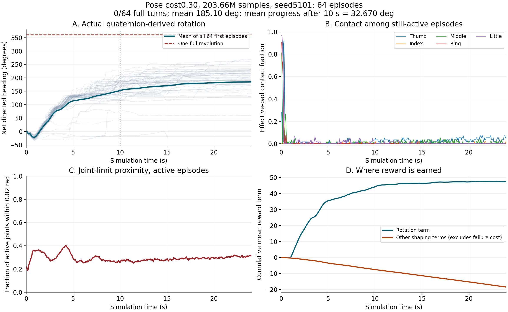

# 阶段1第二轮：单独增强抓姿恢复代价（运行中）

上一轮[约3亿样本基线](../v8-stage1-300m/README.md)完成，但独立完整一圈0/128，阶段1未通过。本轮不是阶段2，也不构成研究对比结果。

仅将归一化关节抓姿偏离代价权重从0.01提高到0.3。其余配方不变：plain、掌心朝上、标称64mm球、正向0.3–0.5rad/s、冻结256初态、8192总环境（8176训练/16在线评估）、rollout16、初始探索标准差0.6、熵系数0.005、从头训练seed49、300M预算。

网络、PPO构造、观测、动作映射、关节限位、物理失效逻辑与完整一圈验收门槛不变。128个随机任务状态的回归检查确认默认0.01与冻结旧实现逐位一致；0.3只改变姿态代价分项，承托和运动项一致。原有任务契约检查通过。

两个训练运行保存的全部初始网络、优化器、状态/价值预处理器逐项完全一致。这个证据控制初始化差异，但不承诺PhysX轨迹逐位可重复。具体见[INITIAL_STATE_COMPARISON.json](INITIAL_STATE_COMPARISON.json)、[CORE_VERIFICATION.json](CORE_VERIFICATION.json)、[REWARD_CONTRACT.json](REWARD_CONTRACT.json)。

本轮运行目录：`logs/roto2_pressure_fruit/plain_seed49/2026-10-20_22-40-21`。训练服务`roto2-stage1-pose030-seed49.service`；实际命令和源码提交见[TRAINING_SPEC.json](TRAINING_SPEC.json)。启动后的检查点已经产生59次PPO更新、7,840,784条环境转移，模型和优化器张量均有限，三个优化器步数均为1888（59×8×4）。这是已保存的启动验证快照，不是此页读取时的实时进度。

设有30M、100M、200M稳定检查点保存，并在完整预算结束后自动运行seed6101/6102各64回合和代表性/最佳后段录像。完整正式验收仍要求每组10秒后平均净转角>90°且出现安全完整一圈，并实际复核录像。阶段2/3等待该门槛通过。

本目录发布启动配置和阶段性验证证据。持续变化的训练日志、权重和最终轨迹在本机保留，结束或明确中止后另行冻结交付，不覆盖上一轮归档。尚无本轮成功结论。

## 31M早期匹配检查点，尚未通过

同样31,338,608样本、训练seed49、测试seed5101、64回合；初始模型/优化器/归一化状态以及测试物体初态一致。

| 配方 | 完整安全一圈 | 物理失败 | 平均总净角 | 后10秒平均净角 | 后段近限位关节比例 |
|---|---:|---:|---:|---:|---:|
| 旧姿态权重0.01 | 0/64 | 5/64 | 97.92° | −0.09° | 72.79% |
| 新姿态权重0.30 | 0/64 | 0/64 | 84.51° | 1.99° | 41.86% |

这个单训练种子的早期对照显示限位停留减少，但有效指腹接触没有恢复，也没有完整一圈。不能把无物理失败当成任务成功。新配方后段平均有效指腹数约0.022；指端接触事件中约88.7%落在当前有效区域之外，未修改区域定义。各指标的精确分母、终止步排除方式及原始来源见[匹配比较](EARLY_MATCHED_COMPARISON.json)与[接触位置诊断](CONTACT_LOCATION_DIAGNOSIS.json)。

[逐回合评估](early31M/evaluation_seed5101.json)、[检查点来源与哈希](early31M/PROVENANCE.json)、[论文与接触恢复候选](LITERATURE_AND_CONTACT_RECOVERY.md)。此处发布早期汇总、逐回合JSON、图表和命令；对应NPZ、日志和模型仍保留本机，待本轮结束后完整冻结交付。当前正在运行的奖励没有加入接近项。

## 101.83M匹配检查点：后段转动改善，稳定性下降，仍未通过

两轮均为101,832,080样本、训练seed49、评估seed5101、64回合；已逐元素核对评估初始物体位姿、目标速度和方向完全一致。对照是同一训练种子的中间检查点，不是多种子结论。

| 配方 | 完整安全一圈 | 物理失败 | 平均总净角 | 后10秒平均净角 |
|---|---:|---:|---:|---:|
| 旧姿态权重0.01 | 0/64 | 9/64 | 158.70° | 2.08° |
| 新姿态权重0.30 | 0/64 | 13/64 | 180.72° | 27.56° |

本轮最大总净转角291.36°，没有任何原始完整一圈；个别回合后10秒净转角最大132.62°，但全体平均27.56°仍低于90°门槛。不能把这个最大值当作阶段1通过。独立评估与动作诊断的非终止步物体轨迹完全匹配。

实际查看图后，仍表现为前段推进、后段趋于平台，有效指腹接触几乎消失。后10秒15,193个仍活动且非终止的环境时间步中，近限位关节占32.30%，平均有效指腹数0.03594。按五指分别平均，指腹中心到球面间隙约14–32mm；这些几何量不等于接触，也不能证明某个换指动作可行。指腹标记从原始接触位置、力和未修改的传感区域重新计算，逐项一致。

另一个实质问题是承托和运动奖励的关系：后段有5,415步满足运动奖励的路径及承托条件，8,668步路径有效但缺乏承托，1,110步路径无效。全部9,444个缺乏承托的后段时间步中，9,061步的果实中心偏移达到25mm，已不满足当前稳定承托的位移条件；有效指腹接触又不足。后段中心偏移中位数26.60mm。多个条件可以同时失败，此计数不能归因成“仅位移导致”。

依据真实位姿和承托记录重新计算后段运动奖励，与保存值的最大差异小于0.00001。这说明27.56°原始后段转角并不全部属于可获奖励的稳定运动；不能只看总转角推断接触已经改善。下一步重点检验接触恢复和位置保持，尚未添加接近项、放宽稳定阈值或改变正在运行的配方。

详细证据：[逐回合评估](milestone100M/evaluation_seed5101.json)、[匹配对照](milestone100M/MATCHED_COMPARISON.json)、[接触恢复和奖励分解](milestone100M/RECONTACT_DIAGNOSIS.json)、[命令及退出状态](milestone100M/DIAGNOSTIC_PIPELINE.json)、[检查点来源](milestone100M/PROVENANCE.json)。图表、JSON和CSV随本分支发布；NPZ、模型和完整日志仍保留本机，最终冻结交付。

为200M和最终诊断增加了预重置压力、接近质量及terminated/truncated记录。新增记录使用环境已有的step快照，不改变奖励、控制或PPO。2个真实物理环境、479步的冒烟验证通过，实际覆盖超时终止；本次未出现物理失败，因此不声称已覆盖物理失败分支，见[验证记录](diagnostic_schema_smoke/VERIFICATION.json)。

## 后续候选的离线检查，尚未用于训练

若完整预算后仍无法持续转动，候选最小修改是新增一个连续接近代价：
`-w * mean(1 - top3(pad_approach_quality))`，先考虑`w=0.025`，保留本轮其余配方作为对照。该接近质量使用当前球心、指腹中心和法向，已经由保存几何重新计算核对。这个top3适配是本项目候选，并非论文原公式。

在当前101.83M轨迹上，排除终止自动复位步后，`w=0.025`对应后段每有效步平均−0.01354、整段按最初64回合平均累计−5.763；理论每步范围为[−0.075,0]。在四指质量都为1的理想合成状态下，只取三指使暂时释放任意一指不额外增加此项代价；真实各指质量不同，释放较好的一指仍可能增加软代价。只有两指接近时仍是有限软代价，既不禁止动作，也不取消原有稳定承托通路。换指组合不固定拇指。置换五指顺序和四指到三指释放的合成检查通过。

这只是固定轨迹上的奖励量级检查，不是学习效果预测。非正辅助代价也不能保证不陷入静止局部最优。完整一圈、后10秒推进、压力及物理失败门槛保持不变，暂未启用此候选。详见[校准结果](APPROACH_CANDIDATE_CALIBRATION.json)及仓库`script/calibrate_roto2_approach_candidate.py`。

补充录像尝试选中了后段转角最大的环境44，但该回合本身有物理失败，不能作为成功样本。录像进程在创建PhysX场景时因显存不足退出，未产生有效视频；训练服务仍正常运行。原始错误日志已保存，不在训练期间再次并行启动渲染。最终验收已安排在训练退出后录制。见[失败记录](milestone100M/RECORDING_FAILURE.json)；此处不声称已经看过该回合视频。

## 203.66M检查：持续旋转仍未通过

本轮203,655,984样本、1,556次更新，独立seed5101共64回合：安全完整一圈0/64，物理失败7/64，平均总净角185.10°，后10秒平均净角32.67°。最大总净角270.54°，最大后段净角128.78°；3个未失败回合后段超过90°，但没有完整一圈，全体平均也未达标。

同一评估初始位姿、目标速度及方向逐元素一致的旧配方检查点为203,664,160样本、1,556次更新：0/64成功，6/64失败，总净角159.82°，后段7.73°。两组相差8,176条转移，旧配方在117M处恢复过训练，本轮截至该检查点未中断。不能称为逐位连续训练的严格因果对照，详见[预算与初态比较](milestone200M/NEAR_BUDGET_COMPARISON.json)。

实际复核诊断图后，仍主要是前段推进，后段有效指腹接触很少。后段16,043个活动且非终止的环境步中，近限位关节占28.83%，平均有效指腹数0.04014；球心偏移中位数26.60mm。9,827个不满足承托的时间步中，9,630步位移达到25mm。探索标准差为0.10750。上述指标描述当前策略，不证明单一因果或物理不可行。原始接触标志、几何接近质量、运动奖励均已重算核对，见[逐回合评估](milestone200M/evaluation_seed5101.json)、[接触及奖励诊断](milestone200M/RECONTACT_DIAGNOSIS.json)。

预重置压力与终止类型记录在这次真实轨迹上覆盖7个物理失败和57个超时，计数与独立评估一致。最大指端力的导出在此后才添加，本检查点轨迹不包含该新字段；不据此虚构直接测得的失败力值。详见[终止记录检查](milestone200M/TERMINAL_RECORD_VERIFICATION.json)。

上一轮已完成的姿态权重0.01训练还补查了上游按在线回报保存的best_agent：独立seed7101共64回合，完整一圈0/64，失败5/64，总净角171.44°，后段7.38°。这是额外候选筛查，不覆盖或替代原来最终检查点的0/128正式验收，也不表示穷举了所有训练时刻。上游评价的是冻结策略快照，而保存的是当时训练模块，因此best文件必须独立验证，不能把其关联在线回报直接当作该文件的真实成绩。见[检查点来源](previous_recipe_best_supplement/PROVENANCE.json)、[评估结果](previous_recipe_best_supplement/evaluation_seed7101.json)。

## 2026-10-21恢复：先完成原配方预算

用户暂停时保存了231,070,112条转移、1,766次PPO更新，检查点SHA256为`9595c81c67f465a5ecc8bfb0ee4afaff08f2278b89e9f526d2d943fd11b96fcd`。收到继续指令后，接续剩余68,929,888条请求预算，姿态权重保持0.30，接近权重明确为0；新增候选不参与这轮PPO。计数按实际完成的并行步记录，最终累计以training_result.json为准。模型/优化器可以恢复，环境及完整RNG状态不能逐位恢复，故不声称等同于未中断训练。

暂停前未完成的接近奖励现已实现为默认关闭的任务选项。关闭时，256组随机任务状态在姿态权重0.01和0.30下与旧实现奖励、分项及承托逐位一致；开启时仅增加一个非正接近代价。保护的网络/PPO构造、动作映射、观测、失败判定AST保持一致。两环境20步真实PhysX冒烟检查开启候选权重0.025通过，输入仍为70维本体状态和432维触觉；这是运行检查，不是学习成功。详见[恢复前验证](resume20261021/PRE_RESUME_VERIFICATION.json)、[续训命令与源码提交](resume20261021/TRAINING_RESUME_SPEC.json)。

后续候选从top3进一步比较了top4：仅三指接近缺少恢复第四个冗余接触的激励，top4以有限软代价鼓励第四指回来，同时保留任何三指及稳定物体承托路径。权重0.025时，在203.66M轨迹上top4后段平均代价约−0.01570/步；理想四指释放一指的附加代价为−0.01875/步，不是动作禁令。该选择尚无PPO学习效果证据，不改变本轮配方。此前top3候选记录保留，新的计算见[候选V2](APPROACH_CANDIDATE_CALIBRATION_V2.json)。

实际续训运行目录为`logs/roto2_pressure_fruit/plain_seed49/2026-10-21_10-46-58`。恢复后的初始检查点与暂停来源的8类模块、99个张量逐项完全一致，见[恢复验证](resume20261021/RESTORE_VERIFICATION.json)。最终评估等待该训练进程结束后运行，当前不声称完成3亿预算或通过阶段1。
